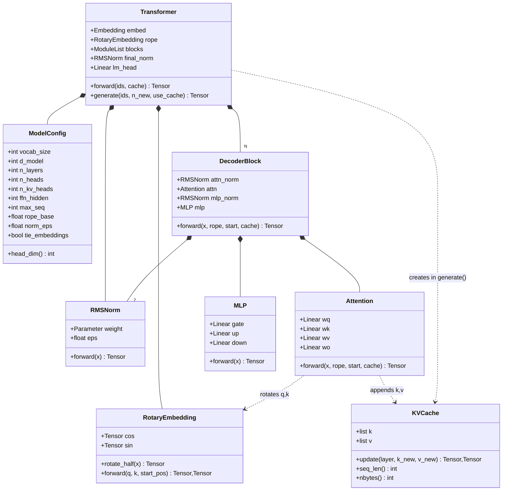

# Step 07 — Build a mini-Llama (the low-level design of a modern decoder)

## The story so far
Steps 01-06 built the parts: tokens ([01](../01_bpe_tokenizer_from_scratch/WALKTHROUGH.md)), RoPE ([02](../02_positional_encodings/WALKTHROUGH.md)), RMSNorm and SwiGLU ([03](../03_norms_and_ffn/WALKTHROUGH.md)), GQA and the KV cache ([04](../04_attention_variants_and_kv_cache/WALKTHROUGH.md)), SDPA ([05](../05_flash_attention_online_softmax/WALKTHROUGH.md)) and MoE ([06](../06_mixture_of_experts/WALKTHROUGH.md)). Module 04 built a GPT-2 style block and module 06 trained a small model with a loop ([06 / step 02](../../06_llm_training_and_lora/02_training_loop/WALKTHROUGH.md)). Now we put the modern parts together as one clean program.

## The pain point
Knowing the parts is not the same as knowing how they connect: where does RoPE get applied relative to the cache? Why must `start_pos` be computed once per forward and not per layer? Which tensors have which shapes? These are the questions in a "design a decoder" or "write a Llama in 100 lines" interview, and the places where real bugs hide (this step's own first version had one, see Debugging).

## The spark
A decoder-only model is a short, regular program: an embedding, N identical blocks, a final norm and an output head. Write each concept as a small class with one job, give every hyperparameter a home in a config dataclass, and keep the cache as an explicit object passed down the call chain.

## Goal
Build `ModelConfig`, `RMSNorm`, `RotaryEmbedding`, `KVCache`, `Attention` (GQA), `MLP` (SwiGLU), `DecoderBlock`, `Transformer` (about 150 lines), train 738k parameters for 300 steps on 128 KB of text, generate with and without the KV cache, and verify the outputs are identical.

## The theory (read this before the interview)
**The low-level design (LLD).**



**The data flow (shapes for batch b, sequence t):**
```
ids (b, t)
  -> embed                      (b, t, d_model)
  -> for each of N blocks:
        h = x + Attention( RMSNorm(x) )     # q (b, H, t, hd), k/v (b, G, t, hd), RoPE on q,k, cache k/v, repeat G->H
        x = h + MLP( RMSNorm(h) )           # SwiGLU, hidden = 8/3 d
  -> final RMSNorm              (b, t, d_model)
  -> lm_head (tied to embed)    (b, t, vocab)   logits; the last position predicts the next token
```
**Parameter count (this config):** embedding 256 x 128 = 32,768 (shared with the head); per block attention `128·128 (q) + 2·128·32 (k,v) + 128·128 (o)` = 40,960, MLP `3·128·352` = 135,168, two RMSNorms 256, giving 176,384; 4 blocks 705,536; plus final norm 128; total **738,432**. The head adds nothing because it is tied: untied it would add another 32,768.

**Training vs generation modes.** *Training / prefill*: whole sequence at once, causal mask, no cache needed (or the cache is filled). *Decode*: one new token, the cache supplies K and V of all earlier tokens; no mask is needed because every cached key is in the past. The same `forward` handles both through `start` (number of tokens already cached).

**Why RoPE is applied before caching.** The cached keys store their *already rotated* value, rotated by their own absolute position. A new query is rotated by its own position, and the score then depends on the difference. Rotating after caching would re-rotate old keys at the wrong angle.

**Why `start` is read once.** Layer 0 appends to the cache before layer 1 runs. If layer 1 asked the cache for its length it would already include the current token. This was the actual bug in the first draft of this file: with the cache the output differed from the uncached run until `start` was computed once in `Transformer.forward` and passed down.

**Weight tying.** Output head weight = embedding matrix: saves `vocab · d_model` parameters and usually helps small models. Large models (Llama 3 8B, Qwen3-8B, gpt-oss) untie them. Qwen2.5-0.5B ties them (27.6% of its parameters are this one matrix, step 08).

**Where MoE, MLA, sliding window would plug in.** MoE: swap `MLP` for the `MoE` class of step 06 (same `forward(x)` signature). MLA: replace `Attention`'s K/V projections and `KVCache` payload with a latent. Sliding window: change the mask in `Attention.forward` and evict old entries in `KVCache.update`. Only these classes change; `Transformer` does not.

**Real-model mapping** is in [step 08](../08_read_a_real_config/WALKTHROUGH.md): the same classes with the names Hugging Face uses (`q_proj`, `input_layernorm`, ...) and a numerical proof of equality.

## Same thing, different names
| Term you will hear | Also called / near-synonyms | Exactly the same? | Difference in one line |
|---|---|---|---|
| Decoder block | transformer layer, `DecoderLayer`, `TransformerBlock` | Yes | attention + MLP with norms and residuals |
| `d_model` | `hidden_size`, `n_embd`, `dim` | Yes | residual stream width |
| `n_layers` | `num_hidden_layers`, `n_layer`, depth | Yes | number of blocks |
| `ffn_hidden` | `intermediate_size`, `d_ff` | Yes | MLP middle width |
| Logits | pre-softmax scores, `lm_head` output | Yes | one score per vocabulary token |
| Weight tying | tied embeddings, `tie_word_embeddings` | Yes | head reuses the embedding matrix |
| KV cache | `past_key_values`, `DynamicCache` | Yes | stored K and V per layer |
| Prefill vs decode | prompt phase vs generation phase | No | many tokens at once vs one token reading the cache |
| Greedy decoding | argmax decoding, temperature 0 | Yes | pick the most likely token each step |
| Teacher forcing | training with the true previous tokens | No | the training-time counterpart of the generation loop |

## Run it
```bash
cd 16_modern_llm_architecture/07_build_mini_llama
python main.py       # about 1-2 min on CPU (300 training steps); reads corpus.txt in this folder
```
`corpus.txt` is 127,662 bytes of this repository's own markdown (module READMEs and walkthroughs), bundled so the step is self-contained and offline.

## Code, step by step
### 1. Imports and seed  (`main.py` lines 14–23)
```python
import math
import time
from dataclasses import dataclass
from pathlib import Path

import torch
import torch.nn as nn
import torch.nn.functional as F

torch.manual_seed(0)
```
- **In simple words:** the only dependency is torch; the seed makes weights and batches repeatable.
- **Exactly:** `dataclass` for the config, `time` for timing, `Path` to find `corpus.txt`.
- **Why it is here:** the printed losses in this walkthrough are reproducible run to run (timings are not).
### 2. ModelConfig: every design choice in one place  (`main.py` lines 27–42)
```python
@dataclass
class ModelConfig:
    vocab_size: int = 256            # byte-level "tokenizer": each byte is a token (see step 01 for real BPE)
    d_model: int = 128               # also called hidden_size / n_embd
    n_layers: int = 4
    n_heads: int = 8                 # query heads
    n_kv_heads: int = 2              # GQA: 4 query heads share each K/V head
    ffn_hidden: int = 352            # ~ 8/3 * d_model rounded up to a multiple of 32
    max_seq: int = 256               # max_position_embeddings
    rope_base: float = 10000.0
    norm_eps: float = 1e-5
    tie_embeddings: bool = True      # output head shares the embedding matrix

    @property
    def head_dim(self):
        return self.d_model // self.n_heads
```
- **In simple words:** a settings sheet for the whole model; change a number here and the whole network changes shape.
- **Exactly:** `vocab_size = 256` because we tokenise by raw bytes (no BPE here, to stay self-contained); `d_model = 128`; `n_heads = 8` with `head_dim = 16`; `n_kv_heads = 2` so each K/V head serves 4 query heads (GQA); `ffn_hidden = 352` (8/3 · 128 = 341.3, rounded up to a multiple of 32 for hardware efficiency); `max_seq = 256`; `rope_base = 10000`; `tie_embeddings = True`. `head_dim` is a derived property.
- **Why it is here:** real models are exactly this: Hugging Face's `config.json` is the same list (step 08).
### 3. RMSNorm  (`main.py` lines 46–52)
```python
class RMSNorm(nn.Module):
    def __init__(self, d, eps):
        super().__init__()
        self.weight, self.eps = nn.Parameter(torch.ones(d)), eps

    def forward(self, x):
        return x * torch.rsqrt(x.pow(2).mean(-1, keepdim=True) + self.eps) * self.weight
```
- **In simple words:** rescale each token vector to unit root-mean-square, then apply a learned per-feature gain.
- **Exactly:** `x * rsqrt(mean(x^2) + eps) * weight`; input and output `(b, t, d_model)`; 128 parameters.
- **Why it is here:** same module as [step 03](../03_norms_and_ffn/WALKTHROUGH.md); used three times per block pair (two per block plus the final one).
### 4. RotaryEmbedding: precompute the cos/sin tables  (`main.py` lines 56–63)
```python
class RotaryEmbedding(nn.Module):
    def __init__(self, head_dim, max_seq, base):
        super().__init__()
        inv_freq = base ** (-torch.arange(0, head_dim, 2).float() / head_dim)     # (head_dim/2,)
        ang = torch.arange(max_seq).float()[:, None] * inv_freq[None, :]          # (max_seq, head_dim/2)
        ang = torch.cat([ang, ang], dim=-1)                                       # (max_seq, head_dim): halves share angles
        self.register_buffer("cos", ang.cos(), persistent=False)                  # buffers move with .to(device), not trained
        self.register_buffer("sin", ang.sin(), persistent=False)
```
- **In simple words:** compute once, for every possible position, how much to rotate each pair of numbers.
- **Exactly:** `inv_freq (head_dim/2,) = base^(-2i/head_dim)`; `ang (max_seq, head_dim/2) = position x inv_freq`; `torch.cat([ang, ang], -1)` gives `(max_seq, head_dim)` because the "rotate-half" layout pairs element `i` with element `i + head_dim/2` and both use the same angle. `register_buffer(..., persistent=False)` makes the tables move with `.to(device)` but keeps them out of the saved weights (they can be recomputed).
- **Why it is here:** doing sin/cos once instead of every forward pass; and it matches Hugging Face's Llama layout (step 08 proves it).
### 5. rotate_half  (`main.py` lines 65–68)
```python
    @staticmethod
    def rotate_half(x):
        x1, x2 = x.chunk(2, dim=-1)
        return torch.cat([-x2, x1], dim=-1)
```
- **In simple words:** the trick that implements a 2-D rotation using two halves of the vector: (a, b) becomes (-b, a).
- **Exactly:** `x.chunk(2, dim=-1)` splits the last axis in two halves `x1, x2` (each `hd/2`); returns `[-x2, x1]`. Then `x·cos + rotate_half(x)·sin` equals `[x1 cos - x2 sin, x2 cos + x1 sin]`, the rotation.
- **Why it is here:** the whole of RoPE in one line without a matrix.
### 6. Apply RoPE to q and k at the right positions  (`main.py` lines 70–74)
```python
    def forward(self, q, k, start_pos):                                           # q: (b, heads, t, hd)  k: (b, kv_heads, t, hd)
        t = q.shape[2]
        cos = self.cos[start_pos:start_pos + t]                                   # absolute positions of THESE tokens
        sin = self.sin[start_pos:start_pos + t]
        return q * cos + self.rotate_half(q) * sin, k * cos + self.rotate_half(k) * sin
```
- **In simple words:** rotate the new tokens according to where they sit in the full sequence, not where they sit in this call.
- **Exactly:** `cos = self.cos[start_pos:start_pos + t]` selects the rows for absolute positions `start_pos ... start_pos+t-1`, shape `(t, head_dim)`, broadcast against `q (b, H, t, hd)` and `k (b, G, t, hd)`. v is never rotated.
- **Why it is here:** when decoding one token with a cache of 20 tokens, `t = 1` and `start_pos = 20`: the token gets position 20, not 0. Wrong here means wrong text.
### 7. KVCache: storage  (`main.py` lines 78–81)
```python
class KVCache:
    def __init__(self, n_layers):
        self.k = [None] * n_layers
        self.v = [None] * n_layers
```
- **In simple words:** a notebook with one page per layer, holding all keys and values seen so far.
- **Exactly:** two Python lists of `None` placeholders, one entry per layer; each will hold a tensor `(b, kv_heads, seq_so_far, head_dim)`.
- **Why it is here:** explicit state passed as an argument keeps the model functional and makes batching/paging (module 21) possible later.
### 8. KVCache.update: append and return everything  (`main.py` lines 83–89)
```python
    def update(self, layer, k_new, v_new):                                        # k_new: (b, kv_heads, t_new, hd)
        if self.k[layer] is None:
            self.k[layer], self.v[layer] = k_new, v_new
        else:
            self.k[layer] = torch.cat([self.k[layer], k_new], dim=2)              # append along the sequence axis
            self.v[layer] = torch.cat([self.v[layer], v_new], dim=2)
        return self.k[layer], self.v[layer]
```
- **In simple words:** add this step's keys and values to the page and hand back the full page.
- **Exactly:** first call stores the tensors; later calls `torch.cat([old, new], dim=2)` along the sequence axis (a copy: simple, but O(n) per step; real engines preallocate or page, see module 06). Returns the full K and V for attention.
- **Why it is here:** this is the data structure that turns O(n²) total decoding work into O(n).
### 9. How many tokens are cached  (`main.py` lines 91–92)
```python
    def seq_len(self):
        return 0 if self.k[0] is None else self.k[0].shape[2]
```
- **Exactly:** 0 when empty else `k[0].shape[2]`, the sequence length of layer 0's page.
- **In simple words:** how long the story is so far.
- **Why it is here:** this number is `start`, the RoPE offset. It is read by the Transformer once per forward (see Attention below for why).
### 10. Cache memory  (`main.py` lines 94–95)
```python
    def nbytes(self):
        return sum(t.numel() * t.element_size() for t in self.k + self.v if t is not None)
```
- **Exactly:** sum of `numel() * element_size()` over all stored tensors.
- **In simple words:** how many bytes the notebook weighs.
- **Why it is here:** lets us check the cache formula from step 04 against reality (20,480 bytes for 20 tokens).
### 11. Attention constructor  (`main.py` lines 99–107)
```python
class Attention(nn.Module):
    def __init__(self, cfg: ModelConfig, layer_idx: int):
        super().__init__()
        self.cfg, self.layer_idx = cfg, layer_idx
        hd = cfg.head_dim
        self.wq = nn.Linear(cfg.d_model, cfg.n_heads * hd, bias=False)
        self.wk = nn.Linear(cfg.d_model, cfg.n_kv_heads * hd, bias=False)
        self.wv = nn.Linear(cfg.d_model, cfg.n_kv_heads * hd, bias=False)
        self.wo = nn.Linear(cfg.n_heads * hd, cfg.d_model, bias=False)
```
- **In simple words:** four bias-free linear maps: queries for 8 heads, keys and values for only 2 heads, and an output mixer.
- **Exactly:** `wq: 128 -> 8·16 = 128`; `wk, wv: 128 -> 2·16 = 32`; `wo: 128 -> 128`. Total 40,960 parameters per layer. `layer_idx` tells the cache which page to use.
- **Why it is here:** GQA lives in these sizes (step 04).
### 12. Project to q, k, v and split into heads  (`main.py` lines 109–114)
```python
    def forward(self, x, rope, start, cache=None):                                # x: (b, t, d_model); start = tokens already cached
        b, t, _ = x.shape
        c = self.cfg
        q = self.wq(x).view(b, t, c.n_heads, c.head_dim).transpose(1, 2)          # (b, heads, t, hd)
        k = self.wk(x).view(b, t, c.n_kv_heads, c.head_dim).transpose(1, 2)       # (b, kv_heads, t, hd)
        v = self.wv(x).view(b, t, c.n_kv_heads, c.head_dim).transpose(1, 2)
```
- **In simple words:** turn each token vector into per-head query, key and value vectors.
- **Exactly:** `self.wq(x)` is `(b, t, 128)`; `.view(b, t, 8, 16)` splits into heads; `.transpose(1, 2)` gives `(b, 8, t, 16)`. k and v are `(b, 2, t, 16)`. `start` is the number of tokens already in the cache, passed down from the `Transformer`.
- **Why it is here:** attention operates per head; heads are a batch dimension.
### 13. Rotate, then cache  (`main.py` lines 115–117)
```python
        q, k = rope(q, k, start)                                                  # rotate BEFORE caching: cached keys keep their positions
        if cache is not None:
            k, v = cache.update(self.layer_idx, k, v)                             # (b, kv_heads, start + t, hd)
```
- **In simple words:** position-stamp the new keys first, then store them.
- **Exactly:** RoPE with offset `start`; then `cache.update(layer, k, v)` returns K and V of length `start + t` (shape `(b, 2, start+t, 16)`).
- **Why it is here:** cached keys must carry their own rotation. (BREAK IT at the bottom of main.py swaps these two lines.)
### 14. GQA: share each KV head with its group  (`main.py` lines 118–119)
```python
        k = k.repeat_interleave(c.n_heads // c.n_kv_heads, dim=1)                 # GQA: share each K/V head with its query group
        v = v.repeat_interleave(c.n_heads // c.n_kv_heads, dim=1)
```
- **In simple words:** four query heads read the same key/value head, so we repeat each KV head four times to line the shapes up.
- **Exactly:** `repeat_interleave(8 // 2 = 4, dim=1)` turns `(b, 2, s, 16)` into `(b, 8, s, 16)`. This copy exists only for the attention call; the cache keeps the small 2-head version.
- **Why it is here:** the memory saving of GQA comes from caching before this line.
### 15. Attention with the right mask, then merge heads  (`main.py` lines 121–122)
```python
        o = F.scaled_dot_product_attention(q, k, v, is_causal=(start == 0 and t > 1))
        return self.wo(o.transpose(1, 2).reshape(b, t, -1))                       # merge heads: (b, t, d_model)
```
- **In simple words:** run fused attention; during prefill hide the future, during one-token decoding show everything cached.
- **Exactly:** `is_causal=(start == 0 and t > 1)`: True for training and for the first prefill, False when decoding with a cache (then `q` is a single position that may see all `start + 1` keys). `o` is `(b, 8, t, 16)`; `transpose(1, 2).reshape(b, t, -1)` gives `(b, t, 128)`; `wo` mixes the heads. Limitation: the code does not support chunked prefill with `t > 1` and `start > 0` (that needs an explicit mask).
- **Why it is here:** this single condition is where the two modes (training/prefill and decode) differ.
### 16. SwiGLU MLP  (`main.py` lines 126–134)
```python
class MLP(nn.Module):
    def __init__(self, cfg: ModelConfig):
        super().__init__()
        self.gate = nn.Linear(cfg.d_model, cfg.ffn_hidden, bias=False)
        self.up = nn.Linear(cfg.d_model, cfg.ffn_hidden, bias=False)
        self.down = nn.Linear(cfg.ffn_hidden, cfg.d_model, bias=False)

    def forward(self, x):
        return self.down(F.silu(self.gate(x)) * self.up(x))
```
- **Exactly:** `gate`, `up: 128 -> 352`; `down: 352 -> 128`; output `down(silu(gate(x)) * up(x))`; 135,168 parameters (3·128·352).
- **In simple words:** the "thinking" part of each block: expand, gate, shrink.
- **Why it is here:** two thirds of the block's parameters; swap this class for an MoE layer to get a DeepSeek-style model.
### 17. DecoderBlock constructor  (`main.py` lines 138–142)
```python
class DecoderBlock(nn.Module):
    def __init__(self, cfg: ModelConfig, layer_idx: int):
        super().__init__()
        self.attn_norm, self.attn = RMSNorm(cfg.d_model, cfg.norm_eps), Attention(cfg, layer_idx)
        self.mlp_norm, self.mlp = RMSNorm(cfg.d_model, cfg.norm_eps), MLP(cfg)
```
- **Exactly:** two RMSNorms and the two sub-layers; 176,384 parameters (40,960 + 135,168 + 2·128).
- **In simple words:** one layer of the model: an attention part and a thinking part, each with its own normaliser.
- **Why it is here:** the model is N copies of this class.
### 18. Block forward: pre-norm residuals  (`main.py` lines 144–146)
```python
    def forward(self, x, rope, start, cache=None):
        x = x + self.attn(self.attn_norm(x), rope, start, cache)                         # x + f(norm(x))
        return x + self.mlp(self.mlp_norm(x))
```
- **In simple words:** read the stream, normalise a copy, let attention (or MLP) produce an update, add the update back.
- **Exactly:** `x = x + attn(norm(x))` then `x + mlp(norm(x))`; the residual `x` itself is never normalised. Shapes stay `(b, t, 128)`.
- **Why it is here:** pre-norm (step 03) keeps the identity path clean.
### 19. Transformer constructor  (`main.py` lines 150–161)
```python
class Transformer(nn.Module):
    def __init__(self, cfg: ModelConfig):
        super().__init__()
        self.cfg = cfg
        self.embed = nn.Embedding(cfg.vocab_size, cfg.d_model)
        self.rope = RotaryEmbedding(cfg.head_dim, cfg.max_seq, cfg.rope_base)
        self.blocks = nn.ModuleList(DecoderBlock(cfg, i) for i in range(cfg.n_layers))
        self.final_norm = RMSNorm(cfg.d_model, cfg.norm_eps)
        self.lm_head = nn.Linear(cfg.d_model, cfg.vocab_size, bias=False)
        if cfg.tie_embeddings:
            self.lm_head.weight = self.embed.weight                               # one matrix, two roles
        self.apply(self._init)
```
- **Exactly:** `embed: Embedding(256, 128)`; `rope`; 4 blocks in an `nn.ModuleList`; `final_norm`; `lm_head: Linear(128, 256, bias=False)`. With `tie_embeddings`, `self.lm_head.weight = self.embed.weight` makes both attributes point to the same Parameter (one tensor, two roles). `self.apply(self._init)` runs `_init` on every sub-module.
- **In simple words:** assemble the parts and tie the output layer to the input table.
- **Why it is here:** the whole model definition fits in these ten lines.
### 20. Weight initialisation  (`main.py` lines 163–166)
```python
    @staticmethod
    def _init(m):
        if isinstance(m, (nn.Linear, nn.Embedding)):
            nn.init.normal_(m.weight, std=0.02)
```
- **Exactly:** every Linear and Embedding weight ~ N(0, 0.02²), the GPT-2/Llama convention. Because of tying, the embedding gets initialised twice (same tensor), harmless. `initial loss 5.537` vs `ln 256 = 5.545` confirms the model starts as a near-uniform guess over 256 bytes.
- **In simple words:** start with small random weights so the first predictions are nearly uniform.
- **Why it is here:** large init values make the first losses explode; a sanity check on the initial loss catches wiring bugs early.
### 21. Transformer forward: ids to logits  (`main.py` lines 168–173)
```python
    def forward(self, ids, cache=None):                                           # ids: (b, t)
        x = self.embed(ids)                                                       # (b, t, d_model)
        start = cache.seq_len() if cache is not None else 0                       # read ONCE: layer 0 updates the cache before layer 1 runs
        for blk in self.blocks:
            x = blk(x, self.rope, start, cache)
        return self.lm_head(self.final_norm(x))                                   # (b, t, vocab)
```
- **In simple words:** look up vectors, run through all blocks, normalise, score every possible next byte.
- **Exactly:** `ids (b, t)` -> `embed` `(b, t, 128)` -> N blocks -> `final_norm` -> `lm_head` `(b, t, 256)`. `start = cache.seq_len() if cache is not None else 0` is computed **once**, before the blocks: layer 0 updates the cache before layer 1 runs, so reading the length inside each layer would give layer 1 a wrong offset (the bug fixed in this file).
- **Why it is here:** this is the model's whole call signature: ids in, logits out, optional cache.
### 22. Greedy generation, with or without the cache  (`main.py` lines 175–185)
```python
    @torch.no_grad()
    def generate(self, ids, n_new, use_cache=True):                               # greedy decoding
        cache = KVCache(self.cfg.n_layers) if use_cache else None
        out = ids.clone()
        inp = ids
        for _ in range(n_new):
            logits = self(inp, cache)                                             # with cache: inp is only the NEW token(s)
            nxt = logits[:, -1].argmax(-1, keepdim=True)                          # (b, 1)
            out = torch.cat([out, nxt], dim=1)
            inp = nxt if use_cache else out                                       # no cache: re-feed the WHOLE sequence
        return out
```
- **In simple words:** repeatedly predict the next byte, append it, and feed again; with the cache we only feed the newest byte.
- **Exactly:** `@torch.no_grad()` disables gradient tracking. Each step: `logits = self(inp, cache)`, `nxt = logits[:, -1].argmax(-1, keepdim=True)` (the last position's scores predict the next token), append to `out`. With the cache, the first call feeds the whole prompt (prefill) and then `inp = nxt` (decode, 1 token); without it `inp = out` re-feeds the whole growing sequence each step, O(n²) total work.
- **Why it is here:** the loop that every serving engine optimises.
### 23. Wrap training in main()  (`main.py` lines 188–188)
```python
def main():
```
- **Exactly:** everything below runs only when the file is executed, not when step 08 imports these classes (`if __name__ == "__main__": main()` at the end).
- **In simple words:** the classes can be imported without starting a training run.
- **Why it is here:** reuse: step 08 imports `Transformer` from this file to prove it equals Hugging Face's Llama.
### 24. Load the text as bytes  (`main.py` lines 191–196)
```python
    cfg = ModelConfig()
    raw = (Path(__file__).parent / "corpus.txt").read_bytes()
    data = torch.tensor(list(raw), dtype=torch.long)                                  # (n_bytes,) values 0..255
    split = int(0.95 * len(data))
    train_data, val_data = data[:split], data[split:]
    print(f"corpus {len(raw):,} bytes -> train {len(train_data):,} | val {len(val_data):,} tokens (vocab {cfg.vocab_size})")
```
- **In simple words:** read the bundled text file and treat each byte as a token.
- **Exactly:** `corpus.txt` is 127,662 bytes; `torch.tensor(list(raw), dtype=torch.long)` is `(127662,)` with values 0..255. 95% (121,278) is train, 6,384 validation.
- **Why it is here:** a byte-level vocabulary needs no tokenizer files; the cost is that the model must learn spelling itself (compare step 01's compression).
### 25. Random training batches  (`main.py` lines 199–203)
```python
    def get_batch(d, batch=16, seq=128):
        ix = torch.randint(0, len(d) - seq - 1, (batch,))
        x = torch.stack([d[i:i + seq] for i in ix])                                   # (batch, seq) inputs
        y = torch.stack([d[i + 1:i + seq + 1] for i in ix])                           # targets: inputs shifted by one
        return x, y
```
- **In simple words:** pick 16 random places in the text, take 128 bytes from each, and the targets are the same bytes shifted by one.
- **Exactly:** `ix` random start offsets `(16,)`; `x, y` both `(16, 128)`; `y[i, j] = x[i, j+1]`: at every position the model predicts the *next* byte (teacher forcing).
- **Why it is here:** next-token prediction is the training objective of every decoder LLM.
### 26. Build the model and count parameters  (`main.py` lines 206–211)
```python
    model = Transformer(cfg)
    n_params = sum(p.numel() for p in model.parameters())                             # parameters() de-duplicates the tied matrix
    print(f"parameters {n_params:,} (embedding {cfg.vocab_size * cfg.d_model:,} counted once because tied)")
    print("per block:", sum(p.numel() for p in model.blocks[0].parameters()), "| attention", sum(p.numel() for p in model.blocks[0].attn.parameters()),
          "| mlp", sum(p.numel() for p in model.blocks[0].mlp.parameters()))
    print(f"initial loss {F.cross_entropy(model(get_batch(val_data)[0]).flatten(0, 1), get_batch(val_data)[1].flatten()).item():.3f} (ln 256 = {math.log(256):.3f})")
```
- **Exactly:** 738,432 parameters (`parameters()` counts the tied matrix once). Per block 176,384 = attention 40,960 + MLP 135,168 + norms 256. Initial validation-style loss 5.537 vs ln(256) = 5.545.
- **In simple words:** a 0.7M-parameter model that starts out guessing uniformly.
- **Why it is here:** matches the hand count in the theory section, a good wiring check.
### 27. Hyperparameters and optimiser  (`main.py` lines 214–215)
```python
    STEPS, LR = 300, 3e-3
    opt = torch.optim.AdamW(model.parameters(), lr=LR, betas=(0.9, 0.95), weight_decay=0.1)
```
- **Exactly:** AdamW with `betas=(0.9, 0.95)` (the LLM convention, a shorter second-moment memory than the default 0.999) and `weight_decay=0.1`; peak lr 3e-3 (high for a tiny model).
- **In simple words:** how fast and how steadily the model learns.
- **Why it is here:** these are the usual pre-training settings, scaled for a toy.
### 28. Learning-rate schedule  (`main.py` lines 216–220)
```python
    t0 = time.time()
    for step in range(STEPS):
        lr = LR * min(1, (step + 1) / 20) * (0.1 + 0.9 * 0.5 * (1 + math.cos(math.pi * step / STEPS)))   # warm-up then cosine decay
        for g in opt.param_groups:
            g["lr"] = lr
```
- **Exactly:** `lr = LR * min(1, (step+1)/20) * (0.1 + 0.9 * cosine)`: 20 warm-up steps up to 3e-3, then a cosine decay to 10% (printed lr: 0.0002 at step 0, 0.0028 at 50, 0.0003 at 299).
- **In simple words:** start gently, learn fast, then slow down to settle.
- **Why it is here:** warm-up avoids early instability; decay improves the final loss.
### 29. One training step  (`main.py` lines 221–226)
```python
        xb, yb = get_batch(train_data)
        loss = F.cross_entropy(model(xb).flatten(0, 1), yb.flatten())                 # (b*t, vocab) vs (b*t,)
        opt.zero_grad(set_to_none=True)
        loss.backward()
        torch.nn.utils.clip_grad_norm_(model.parameters(), 1.0)
        opt.step()
```
- **Exactly:** forward `model(xb)` gives `(16, 128, 256)`; `.flatten(0, 1)` makes `(2048, 256)` and `yb.flatten()` `(2048,)` for `F.cross_entropy`; `zero_grad(set_to_none=True)`, `backward()`, gradient clipping at norm 1.0, `opt.step()`. The sequence matches [06 / step 02](../../06_llm_training_and_lora/02_training_loop/WALKTHROUGH.md).
- **In simple words:** guess, measure the error, find who is to blame, nudge the weights.
- **Why it is here:** the loop falls from 5.56 at step 0 to 2.2 by step 299 (below).
### 30. Progress log  (`main.py` lines 227–228)
```python
        if step % 50 == 0 or step == STEPS - 1:
            print(f"step {step:>3} | lr {lr:.4f} | loss {loss.item():.3f}")
```
- **Exactly:** prints the step, lr and current batch loss every 50 steps: 5.568, 3.182, 2.713, 2.474, 2.035, 2.039, 2.083 (single-batch losses are noisy, hence 2.035, 2.039 then 2.083).
- **In simple words:** watch the loss go down.
- **Why it is here:** a model that does not lower its loss has a bug.
### 31. Validation loss  (`main.py` lines 229–233)
```python
    model.eval()
    with torch.no_grad():
        vx, vy = get_batch(val_data, batch=64)
        vloss = F.cross_entropy(model(vx).flatten(0, 1), vy.flatten()).item()
    print(f"train time {time.time() - t0:.0f}s | val loss {vloss:.3f} nats/byte = {vloss / math.log(2):.2f} bits/byte | perplexity {math.exp(vloss):.2f}")
```
- **Exactly:** validation loss 2.098 nats/byte = 3.03 bits/byte, perplexity 8.15 (a random guess is 256). `torch.no_grad()` and a held-out 5% slice. `model.eval()` is a no-op here (no dropout/batchnorm) but is the correct habit.
- **In simple words:** the model is as unsure as choosing among about 9 equally likely bytes at each position.
- **Why it is here:** training loss alone cannot reveal over-fitting; this model is too small and trained too briefly to over-fit.
### 32. Generate with and without the cache  (`main.py` lines 236–243)
```python
    prompt = torch.tensor([list("The attention".encode())])                           # (1, 13) bytes
    N_NEW = 200
    t0 = time.time()
    out_cache = model.generate(prompt, N_NEW, use_cache=True)
    t_cache = time.time() - t0
    t0 = time.time()
    out_nocache = model.generate(prompt, N_NEW, use_cache=False)
    t_nocache = time.time() - t0
```
- **Exactly:** prompt `"The attention"` as 13 byte ids; 200 new greedy tokens each way; timings 0.13 s with the cache vs 0.36 s without (2.8x in this run; timings vary with machine load and at this size Python overhead dominates; the gap widens with length because the no-cache cost is quadratic).
- **In simple words:** two ways to produce the same text, one far less wasteful.
- **Why it is here:** the experiment that justifies the cache.
### 33. Show the text and the identity check  (`main.py` lines 244–248)
```python
    print("\n--- generated text (greedy, with cache) ---")
    print(bytes(out_cache[0].tolist()).decode("utf-8", errors="replace"))
    print("---")
    print("with cache == without cache:", torch.equal(out_cache, out_nocache))
    print(f"time: cache {t_cache:.2f}s | no cache {t_nocache:.2f}s | speedup {t_nocache / t_cache:.1f}x")
```
- **Exactly:** output starts `The attention the the the the ...`: a repetition loop, normal for greedy decoding from a tiny, briefly trained model (not a bug; sampling would vary it). `torch.equal(out_cache, out_nocache)` is `True`: the 213 generated ids are identical.
- **In simple words:** both methods write exactly the same text, which is the proof the cache is correct.
- **Why it is here:** the correctness test for any KV-cache implementation: cached and uncached greedy outputs must match token for token.
### 34. Compare logits for one step  (`main.py` lines 251–255)
```python
    with torch.no_grad():
        full = model(out_cache[:, :20])[:, -1]
        cache = KVCache(cfg.n_layers)
        model(out_cache[:, :19], cache)
        step_logits = model(out_cache[:, 19:20], cache)[:, -1]
```
- **Exactly:** `full` = logits at the last position of a 20-token forward; `step_logits` = prefill 19 tokens into a cache, then feed token 20. Max absolute difference 4.3e-06 (float32 rounding), a finer test than comparing argmax tokens.
- **In simple words:** even the raw scores match, not only the winners.
- **Why it is here:** token equality can hide small numeric drift; logits equality cannot.
### 35. Cache size vs the formula  (`main.py` lines 256–257)
```python
    print("max |logit diff| full vs cached step:", (full - step_logits).abs().max().item())
    print(f"cache after 20 tokens: {cache.nbytes()} bytes = {cache.nbytes() / 20:.0f} bytes/token (formula 2*layers*kv_heads*hd*4 = {2 * cfg.n_layers * cfg.n_kv_heads * cfg.head_dim * 4})")
```
- **Exactly:** 20,480 bytes for 20 tokens = 1,024 bytes/token = `2 · 4 layers · 2 kv_heads · 16 · 4 bytes (fp32)`.
- **In simple words:** the bytes in memory match the formula from step 04.
- **Why it is here:** connects theory to measured memory. In bf16 it would be half.
### 36. Causality test inputs  (`main.py` lines 260–264)
```python
    with torch.no_grad():
        a = torch.randint(0, 256, (1, 30))
        b = a.clone()
        b[0, 20:] = torch.randint(0, 256, (10,))                                      # change only the LAST 10 tokens
        la, lb = model(a), model(b)
```
- **Exactly:** two 30-byte sequences identical in the first 20 bytes, different in the last 10; both are run through the model.
- **In simple words:** change the future and see whether the past notices.
- **Why it is here:** the cheapest test that the mask works.
### 37. Causality and tying checks  (`main.py` lines 265–266)
```python
    print("causality: logits at positions < 20 unchanged when later tokens change:", torch.allclose(la[:, :20], lb[:, :20], atol=1e-5))
    print("tied weights share memory:", model.lm_head.weight.data_ptr() == model.embed.weight.data_ptr())
```
- **Exactly:** logits at positions < 20 are equal (`True`, `atol=1e-5`); `data_ptr()` of `lm_head.weight` equals that of `embed.weight` (`True`): one block of memory.
- **In simple words:** the model cannot cheat by looking ahead, and the head really shares the embedding.
- **Why it is here:** two assertions that catch the most common decoder bugs (a leaking mask and silently untied weights).
### 38. Entry point  (`main.py` lines 269–270)
```python
if __name__ == "__main__":
    main()
```
- **Exactly:** runs `main()` only when executed as a script, so `import` is side-effect free.
- **In simple words:** run the experiment only if this file is the program.
- **Why it is here:** lets step 08 reuse the classes.

## Syntax explained
| Syntax | Meaning | Tiny example |
|---|---|---|
| `@dataclass` | auto-generates `__init__` etc. from annotated fields | `ModelConfig(d_model=256)` |
| `@property` | method used like an attribute | `cfg.head_dim` |
| `@staticmethod` | method without `self` | `rotate_half` |
| `register_buffer(name, t, persistent=False)` | module state that is not a parameter and not saved | cos/sin tables |
| `x.chunk(2, dim=-1)` | split into 2 equal parts | halves of a head |
| `[None] * n` | list of n Nones | empty cache slots |
| `self.apply(fn)` | call fn on every sub-module | init |
| `a if cond else b` | conditional expression | `inp = nxt if use_cache else out` |
| `@torch.no_grad()` | decorator: no gradients inside | `generate` |
| `def main(): ...` / `if __name__ == "__main__":` | run only as a script | import safety |

## Libraries & functions
| Name | Built-in / 3rd-party | What it does | Important args | Returns |
|---|---|---|---|---|
| `nn.Embedding(V, d)` | torch | id to vector lookup | rows, width | module |
| `F.scaled_dot_product_attention` | torch | fused attention | `is_causal` | `(b, h, t, hd)` |
| `F.cross_entropy(logits, targets)` | torch | softmax + negative log-likelihood | `(N, V)`, `(N,)` | scalar |
| `torch.optim.AdamW` | torch | Adam with decoupled weight decay | `lr, betas, weight_decay` | optimiser |
| `clip_grad_norm_` | torch | rescale gradients to a max norm | params, max_norm | float |
| `torch.randint(lo, hi, size)` | torch | random ints | | tensor |
| `tensor.argmax(-1, keepdim=True)` | torch | index of the maximum | dim | tensor |
| `torch.equal(a, b)` | torch | exact equality | | bool |

## Execution trace (real run)
```text
corpus 127,662 bytes -> train 121,278 | val 6,384 tokens (vocab 256)
parameters 738,432 (embedding 32,768 counted once because tied)
per block: 176384 | attention 40960 | mlp 135168
initial loss 5.537 (ln 256 = 5.545)
step   0 | lr 0.0002 | loss 5.568
step  50 | lr 0.0028 | loss 3.182
step 100 | lr 0.0023 | loss 2.713
step 150 | lr 0.0017 | loss 2.474
step 200 | lr 0.0010 | loss 2.035
step 250 | lr 0.0005 | loss 2.039
step 299 | lr 0.0003 | loss 2.083
train time 16s | val loss 2.098 nats/byte = 3.03 bits/byte | perplexity 8.15

--- generated text (greedy, with cache) ---
The attention and the step the the step the step the step the step the step the step the step the step the step the step and the step and the step a step and the step a step and a step and a step steperater the st
---
with cache == without cache: True
time: cache 0.13s | no cache 0.36s | speedup 2.8x
max |logit diff| full vs cached step: 2.384185791015625e-06
cache after 20 tokens: 20480 bytes = 1024 bytes/token (formula 2*layers*kv_heads*hd*4 = 1024)
causality: logits at positions < 20 unchanged when later tokens change: True
tied weights share memory: True
```
Reading it: the initial loss 5.537 is ln 256 (5.545): a uniform guess. The loss drops to about 2.1 in 300 steps (about 16 s on this CPU; yours will differ). Validation perplexity 8.15 means the model is as uncertain as picking among ~8 bytes. The identity check and the 2e-6 logit difference prove the KV cache is exact. The repetition in the text is greedy decoding on a tiny model.

## Experiments (change ONE thing)
Every row below was run on a temporary copy of `main.py` (the real file is untouched), with the full 300 steps (about 14 s each on this machine; yours will differ). Baseline of the same session: val loss 2.098 (perplexity 8.15), generation speedup 2.7x, cache 1024 bytes/token. The data are one seed and one short run, so loss differences of about 0.1 between rows are within noise; the parameter and byte counts are exact.

| Change | What you will see | Why |
|---|---|---|
| `n_kv_heads = 8` (MHA) (measured) | parameters 836,736 (was 738,432); cache 4096 bytes/token (was 1024); val loss 2.075; cached == uncached still True | K and V projections are 4x wider and the cache is 4x bigger, as the formula `2 * layers * kv_heads * hd * 4` says. Quality at this size is not visibly different. |
| `n_kv_heads = 1` (MQA) (measured) | parameters 722,048; cache 512 bytes/token; val loss 2.001 | Half the baseline cache, a quarter of MHA's, and at this tiny scale no loss penalty. Large models are where the quality gap between MQA and GQA shows up. |
| `tie_embeddings = False` (measured) | parameter line prints 771,200 (was 738,432; the extra 32,768 is a separate output matrix); `tied weights share memory: False`; val loss 2.248 (was 2.098) | An untied head is a second, separately trained vocab x d matrix. At small d and a small vocab tying saves parameters and often helps; large models often untie. |
| `LR = 3e-2` instead of `3e-3` (measured) | val loss 2.585, perplexity 13.26 (was 2.098 and 8.15); generation loops on `and and and` | Ten times the learning rate is too aggressive for AdamW here: the loss stalls near 2.6 instead of reaching 2.0. Learning rate is the first thing to sweep. |
| `is_causal=False` in the attention call (measured) | val loss collapses to 0.039 (perplexity 1.04) and generation degrades to `sssss...`, `with cache == without cache: False`, causality check `False` | See drill 1: a loss that is "too good" is a bug signal, not a win. |

## Debugging practice
**BREAK IT drill 1: the cache stores keys before rotating them.** In `Attention.forward`:

```diff
-        q, k = rope(q, k, start)
-        if cache is not None:
-            k, v = cache.update(self.layer_idx, k, v)
+        if cache is not None:
+            k, v = cache.update(self.layer_idx, k, v)
+        q, k = rope(q, k, start)
```

Symptom (real run), training and the plain forward look fine, but the cache check fails:

```text
with cache == without cache: False
max |logit diff| full vs cached step: 4.267238616943359
```

and generation with the cache turns to repeating `athorathorathor...`.

Root cause: after `cache.update`, `k` holds all cached keys plus the new one, and `rope(..., start)` then rotates the whole block with the angles of `start .. start + t` as if every cached key were new. Old keys get re-rotated at the wrong positions. Fix: rotate the new k first, then cache it, so cached keys keep the rotation of their own position.

**BREAK IT drill 2: read the cache length per layer instead of once.** In `Transformer.forward`:

```diff
-        start = cache.seq_len() if cache is not None else 0
-        for blk in self.blocks:
-            x = blk(x, self.rope, start, cache)
+        for blk in self.blocks:
+            start = cache.seq_len() if cache is not None else 0
+            x = blk(x, self.rope, start, cache)
```

Symptom (real run):

```text
with cache == without cache: False
max |logit diff| full vs cached step: 1.3289707899093628
```

Root cause: layer 0 appends to the cache before layer 1 runs, so `seq_len()` already includes the current token and layer 1 onward use positions that are too large by `t`. Fix: read `start` once, before the loop, exactly as the comment in the file says.

**BREAK IT drill 3: remove the causal mask (the loss lies to you).** Replace `is_causal=(start == 0 and t > 1)` with `is_causal=False`. Training loss falls to 0.025 and validation perplexity to 1.04, absurdly good for 300 steps on 128 KB of text, while `causality: ... False` and generation turns to `ssss...`. The model reads the next byte from the input, which at generation time does not exist. Fix: restore the mask. Rule: if a tiny model gets near-zero loss, look for leakage before celebrating.

## Common mistakes
- Rotating keys after they are cached, or rotating the cached block again (drill 1). Rotate each new k once, at its own absolute position.
- Reading the cache length inside the layer loop (drill 2): all layers must see the same `start`.
- Using the causal mask while decoding a single cached token. One new query may see everything cached, so no mask (`is_causal` only for prefill, `t > 1`).
- Judging architecture choices (MHA vs MQA, tied vs untied) from one 300-step run: differences of 0.1 in loss are noise at this scale.
- Counting the tied embedding twice when you tally parameters, or forgetting that untied adds a second vocab x d matrix.
- Believing the KV cache changes the answer. It must not: cached and uncached greedy outputs are identical and logits differ only by float rounding (about 1e-6).

## Rebuild checklist
- [ ] `ModelConfig` dataclass with `head_dim` property
- [ ] `RMSNorm`, `RotaryEmbedding` (cos/sin buffers, `rotate_half`, `start_pos`), `KVCache.update`
- [ ] `Attention`: project, view/transpose, RoPE, cache, `repeat_interleave`, SDPA, merge heads
- [ ] `DecoderBlock`: `x = x + attn(norm(x)); x = x + mlp(norm(x))`
- [ ] `Transformer`: embed, blocks, final norm, tied head; `start` computed once
- [ ] the cached == uncached greedy equality test and the causality test

## The new problem (cliffhanger)
Our toy is a miniature of real models, but is it *really* the same? A model you read in a config file or a paper is never described in your class names. To work with real checkpoints you need to read a `config.json` and a list of tensor names and know what each one means. Step 08 does that for Qwen2.5-0.5B and proves our model equals Hugging Face's Llama numerically: [Step 08 — read a real config](../08_read_a_real_config/WALKTHROUGH.md).

> **Say it aloud (interview box):** "A decoder is an embedding, N pre-norm blocks, a final RMSNorm and a tied output head. Each block adds attention (GQA with RoPE applied to q and k before caching) and a SwiGLU MLP to the residual stream. The KV cache stores post-RoPE keys and values per layer; decoding feeds one token with a position offset equal to the cache length, and the result must match the uncached run exactly."
