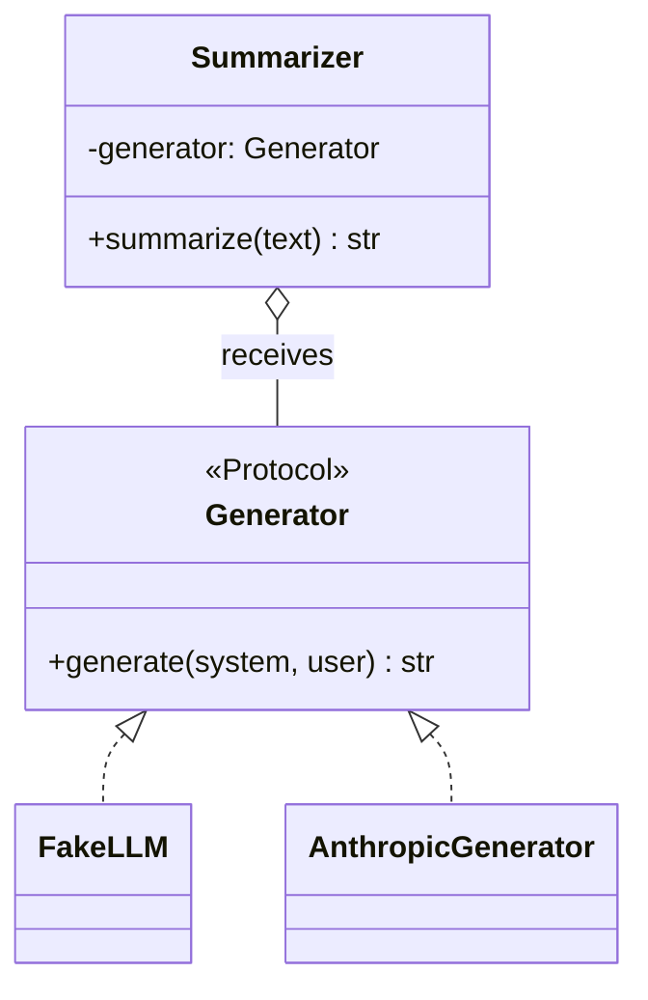
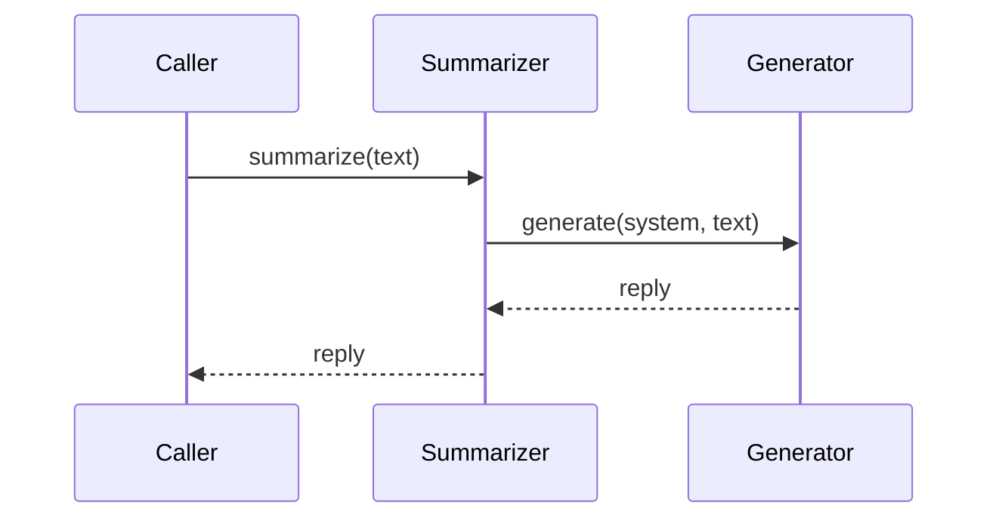

# Step 01 — LLD foundations: classes, contracts and the vocabulary of object design

## The story so far
This is the first step of module 20. Earlier modules built the pieces (a tokenizer in [04](../../04_llm_fundamentals/), a RAG pipeline in [14](../../14_rag_and_retrieval/08_rag_pipeline_end_to_end/WALKTHROUGH.md), an agent loop in [08](../../08_agent_harness/)) as scripts and one big class. Module [10](../../10_ml_system_architecture/README.md) drew the boxes and arrows (HLD). Now we open one box and design what is inside it.

## The pain point
A working demo is not a design. In [14/08](../../14_rag_and_retrieval/08_rag_pipeline_end_to_end/main.py) `RAGPipeline.__init__` loads two models, builds an index and creates a BM25 object, all in the constructor. To test it you must load the models. To swap the re-ranker you must edit the class. To add a Qdrant store you must change five methods. That is what an LLD interview round probes: can you split code so each part can change, be tested and be reasoned about on its own?

## The spark
Give every part a small **contract** (what it needs, what it returns), make the data **immutable value objects**, and let a class **receive** its collaborators instead of building them (dependency injection). Then a fake, a real model and a cloud API are interchangeable, and a test needs no network.

## Goal
Be able to say what LLD is, name the five SOLID principles with an LLM-app example each, choose between `typing.Protocol` and an abstract base class, use frozen/slots dataclasses and enums, apply dependency injection, and read a mermaid class diagram and sequence diagram. You run 60 lines that prove each claim.

## The theory (read this before the interview)
### LLD vs HLD
| | High-level design (HLD, system design, module 10) | Low-level design (LLD, object design, this module) |
|---|---|---|
| Question | Which services, stores and queues? How does it scale? | Which classes, interfaces, methods? How do they collaborate and fail? |
| Output | Box-and-arrow architecture, capacity numbers, SLOs | Class diagram, sequence diagram, interfaces, edge cases, tests |
| Unit | Service, database, queue | Class, function, protocol, dataclass |
| Typical LLM-app question | "Design a ChatGPT-over-docs product for 10M users" | "Design the classes of a RAG service so I can swap the vector DB and the model" |
| What a good answer shows | Trade-offs, bottlenecks, back-of-envelope maths | Clean boundaries, patterns used for a reason, testability, failure handling |

An LLD answer follows a fixed order: **requirements -> entities (nouns) -> interfaces (verbs) -> class diagram -> sequence diagram -> edge cases -> tests**. Step 10 applies it six times.

### SOLID, each with an LLM-app example
| Principle | One line | LLM example in ragkit |
|---|---|---|
| **S**ingle responsibility | a class has one reason to change | `PromptBuilder` only builds prompts; it does not call the model or count citations |
| **O**pen/closed | open to extension, closed to modification | add a retriever by registering a name (step 05); `RagService` is untouched |
| **L**iskov substitution | a subtype must work wherever its base works | every `VectorStore` (memory, Qdrant) passes the same contract test |
| **I**nterface segregation | many small interfaces beat one fat one | `Retriever` has one method; a reranker is not forced to implement `upsert` |
| **D**ependency inversion | depend on abstractions, receive them | `RagService(retriever, reranker, builder, generator, ...)` takes Protocols, never `import anthropic` |

### Protocol (structural) vs ABC (nominal)
- **`abc.ABC` + `@abstractmethod`**: a class must *inherit* and implement the methods; Python refuses to instantiate an incomplete subclass (`TypeError: Can't instantiate abstract class ...`). Good when you ship a base class with shared code (Template Method, step 05).
- **`typing.Protocol`**: "any object with these methods fits". No inheritance. A static checker (mypy, pyright) verifies it. Good for boundaries you do not own (a vendor client, a test fake).
- `@runtime_checkable` lets `isinstance(x, Generator)` work, but it **only checks that the attribute names exist**, not their signatures (see Experiments).
- Rule of thumb used in ragkit: **Protocol for contracts between components, ABC only when we also ship shared behaviour.**

### Dataclasses, value objects, enums
- A **value object** has no identity beyond its fields: two `Chunk("a")` are equal and interchangeable. Make them `@dataclass(frozen=True, slots=True)`.
- `frozen=True`: assignment raises `FrozenInstanceError`; `__hash__` is generated, so objects can be dict keys and set members. It is **shallow**: a list field can still be mutated, and then hashing fails.
- `slots=True` (Python 3.10+): fields live in fixed slots instead of a per-object `__dict__`: less memory (344 vs 56 bytes in Experiments) and no accidental new attributes.
- `Enum` (use `class Role(str, Enum)`): a closed set of values. `Role("admin")` raises `ValueError` at the boundary instead of a typo travelling through the system. The `str` mixin makes it compare equal to its string and serialise as JSON.
- **Entity vs value object**: an entity has a stable id and changing state (a conversation session); a value object is replaced, never edited (a chunk). Prefer values.

### Dependency injection (DI)
A class *receives* what it needs through its constructor (or a method argument) instead of creating it. Without DI: `self.client = anthropic.Anthropic()` inside `__init__` - untestable without a key. With DI: `Summarizer(generator)`. You do not need a framework: **plain constructor arguments are DI**. A "composition root" (`build_system` in step 05) is the one place that creates real objects and wires them.

### Reading diagrams
**Class diagram (mermaid `classDiagram`)**: boxes are types; `<|..` = implements a Protocol/interface; `<|--` = inherits; `*--` = composition (owns, same lifetime); `o--` = aggregation (has a reference); `..>` = depends on/uses. **Sequence diagram**: vertical lifelines are objects, horizontal arrows are calls in time order, `alt/else` boxes show branches. A small example:



## Same thing, different names
| Term you will hear | Also called / near-synonyms | Exactly the same? | Difference in one line |
|---|---|---|---|
| LLD | low-level design, object design, class design, machine-coding round | Mostly | Same round type; "machine coding" additionally wants running code in 60-90 minutes. |
| HLD | system design, architecture design | Mostly | HLD picks services and stores; LLD designs the classes inside one service. |
| Interface | protocol, abstract base class, contract, port | No | Interface is the idea; `Protocol` is structural (no inheritance), `ABC` is nominal (must inherit). |
| Dependency injection | inversion of control (IoC), constructor injection | Close | DI is one way to get IoC; a DI *framework* is optional, constructor arguments are enough. |
| Value object | immutable dataclass, DTO, record | Close | A DTO only carries data across a boundary; a value object also has equality-by-value and often validation. |
| Mock / fake / stub | test double | No | Stub returns canned data; fake is a working simplified implementation (`HashingEmbedder`); mock also checks how it was called. |

## Run it
```bash
# from this step folder
HF_HUB_OFFLINE=1 python main.py
# or from the repo root
HF_HUB_OFFLINE=1 .venv/bin/python 20_llm_system_lld/01_lld_foundations/main.py
```


## Code, step by step
`main.py` is short, so every block is listed. The only ragkit import is the `Generator` Protocol.

#### Walking `main.py`

### 1. Header: what the file proves and how to run it  (`main.py` lines 1–13)
```python
"""
GOAL:  The vocabulary of low-level design, shown in 60 lines of running code: Protocol vs ABC, frozen+slots
       dataclasses, enums, and dependency injection (the thing that makes LLM code testable offline).

RUN (from this step folder):  python main.py
RUN (from repo root):         HF_HUB_OFFLINE=1 .venv/bin/python 20_llm_system_lld/01_lld_foundations/main.py
EXPECTED OUTPUT (shortened):
    Shouter is a Generator? True (no inheritance)
    ABC without the method -> TypeError: Can't instantiate abstract class ...
    frozen -> FrozenInstanceError | slots typo -> TypeError | mutable -> silently changed
    DI: real pipeline answer vs test answer, same Summarizer class
NEEDS: only the standard library + the ragkit package next to this folder (no models, no network).
"""
```
- **In simple words:** A label on the box saying what is inside and how to open it.
- **Exactly:** A module docstring: GOAL, RUN, EXPECTED OUTPUT, NEEDS. Not executed; shown by `help()`.
- **Why it is here:** A reader (or you in six months) knows the file's purpose and prerequisites without reading code.

### 2. Imports and making `ragkit` importable  (`main.py` lines 14–21)
```python
import sys
from abc import ABC, abstractmethod
from dataclasses import FrozenInstanceError, dataclass
from enum import Enum
from pathlib import Path

sys.path.insert(0, str(Path(__file__).resolve().parents[1]))        # make `import ragkit` work from any cwd
from ragkit.protocols import Generator                              # a typing.Protocol: "anything with generate(system, user)"
```
- **In simple words:** We load standard-library tools and tell Python where our own package lives.
- **Exactly:** `sys.path.insert(0, parents[1])` puts `20_llm_system_lld/` first on the module search path, so `from ragkit.protocols import Generator` works whatever directory you run from. `Generator` is a `typing.Protocol` decorated `@runtime_checkable`.
- **Why it is here:** Without the path line, `python main.py` from inside the step folder raises `ModuleNotFoundError: No module named 'ragkit'`.

### 3. A class that satisfies a Protocol without inheriting  (`main.py` lines 24–30)
```python
# ---- 1. Protocol (structural) vs ABC (nominal) -----------------------------------------------------------
class Shouter:                                                      # does NOT inherit from Generator
    def generate(self, system: str, user: str) -> str:
        return user.upper()


print("Shouter is a Generator?", isinstance(Shouter(), Generator), "(no inheritance)")
```
- **In simple words:** `Shouter` never says it is a `Generator`; it just has the right method, like a plug that fits a socket.
- **Exactly:** `isinstance(Shouter(), Generator)` -> `True` (printed). `Protocol` is structural typing: membership is decided by the presence of `generate`, not by a base class.
- **Why it is here:** This is why a test fake, a Qdrant adapter and a vendor SDK wrapper can all plug in without touching the interface.

### 4. The nominal alternative: an abstract base class  (`main.py` lines 33–45)
```python
class BaseGenerator(ABC):                                           # nominal: you MUST inherit and implement
    @abstractmethod
    def generate(self, system: str, user: str) -> str: ...


class Lazy(BaseGenerator):                                          # forgot to implement generate()
    pass


try:
    Lazy()
except TypeError as e:
    print("ABC without the method -> TypeError:", str(e)[:60], "...")
```
- **In simple words:** With an ABC you must formally join the club (inherit) and fill in every required method.
- **Exactly:** `@abstractmethod` marks `generate` as required. `Lazy` inherits but does not implement it, so `Lazy()` raises `TypeError: Can't instantiate abstract class Lazy without an implementation...` at construction time.
- **Why it is here:** Shows the trade-off: ABC fails early and loudly at instantiation; Protocol fails only in the type checker (or at the first call).

### 5. Two dataclasses: mutable and frozen+slots  (`main.py` lines 48–56)
```python
# ---- 2. dataclasses: mutable vs frozen vs slots ----------------------------------------------------------
@dataclass
class MutableChunk:
    text: str


@dataclass(frozen=True, slots=True)
class Chunk:
    text: str
```
- **In simple words:** Same data, but one can be edited behind your back and the other cannot.
- **Exactly:** `@dataclass` generates `__init__`, `__repr__`, `__eq__`. `frozen=True` makes assignment raise and generates `__hash__`; `slots=True` removes the per-instance `__dict__`.
- **Why it is here:** Chunks and requests are shared between components, caches and threads. Mutable shared state is where "who changed this?" bugs come from.

### 6. Try to change each one  (`main.py` lines 59–70)
```python
m, c = MutableChunk("a"), Chunk("a")
m.text = "changed"                                                  # allowed: shared mutable state is a bug factory
print("mutable ->", m.text)
try:
    c.text = "changed"
except FrozenInstanceError as e:
    print("frozen  -> FrozenInstanceError:", e)
try:
    c.txt = "typo"
except (AttributeError, TypeError) as e:
    print("slots typo ->", type(e).__name__)
print("hashable value object:", {c: 1}[Chunk("a")], "| equal by value:", c == Chunk("a"))
```
- **In simple words:** Edit the mutable one (works silently) and the frozen one (refused).
- **Exactly:** Prints `mutable -> changed`; `frozen -> FrozenInstanceError: cannot assign to field 'text'`; `slots typo -> TypeError` (a CPython quirk of frozen+slots: the message is `super(type, obj): obj must be an instance or subtype of type`); `{c: 1}[Chunk('a')]` returns 1 because equal frozen objects hash equal.
- **Why it is here:** Proves immutability, typo protection and hashability with real exceptions instead of claims.

### 7. A closed set of roles with an Enum  (`main.py` lines 73–83)
```python
# ---- 3. Enum: a closed set of values instead of magic strings --------------------------------------------
class Role(str, Enum):
    USER = "user"
    ASSISTANT = "assistant"


print("Role('user') ->", Role("user"), "| Role.USER == 'user' ->", Role.USER == "user")
try:
    Role("admin")
except ValueError as e:
    print("bad role rejected:", e)
```
- **In simple words:** Instead of the string `"user"` typed in twenty places, there are exactly two allowed values.
- **Exactly:** `class Role(str, Enum)`. `Role('user')` -> `Role.USER`; `Role.USER == 'user'` -> `True` (str mixin); `Role('admin')` raises `ValueError: 'admin' is not a valid Role`.
- **Why it is here:** A misspelt role such as `"usr"` fails at the edge, not three layers deeper inside an API call.

### 8. A Summarizer that receives its generator  (`main.py` lines 86–97)
```python
# ---- 4. Dependency injection: the class receives its collaborator, it does not build it ---------------------
class Summarizer:
    def __init__(self, generator: Generator):                       # depends on the abstraction, not on a vendor
        self.generator = generator

    def summarize(self, text: str) -> str:
        return self.generator.generate("Summarize in one line.", text)


class FakeLLM:                                                      # a 3-line test double: instant, free, deterministic
    def generate(self, system: str, user: str) -> str:
        return f"summary({len(user.split())} words)"
```
- **In simple words:** The class asks for a worker in its constructor instead of hiring one itself.
- **Exactly:** `Summarizer.__init__(self, generator: Generator)` stores it; `summarize` calls `generator.generate(system, text)`. `FakeLLM` returns `summary(N words)` with no model, network or cost.
- **Why it is here:** Remove the injection (build the client inside `__init__`) and every unit test needs credentials and money.

### 9. Same class, two different collaborators  (`main.py` lines 100–101)
```python
print("DI with a fake :", Summarizer(FakeLLM()).summarize("one two three four"))
print("DI with another:", Summarizer(Shouter()).summarize("one two three four"))
```
- **In simple words:** Swap the worker; the manager class does not change.
- **Exactly:** Prints `summary(4 words)` with `FakeLLM` and `ONE TWO THREE FOUR` with `Shouter`. Neither `Summarizer` line changed: this is the open/closed and dependency-inversion principles in practice.
- **Why it is here:** This is the whole point of LLD for LLM apps: the model is the most volatile, expensive, nondeterministic part, so it sits behind a seam.

### 10. Exercises left in the file  (`main.py` lines 103–105)
```python
# TRY IT: add a method `def stream(self)` to the Generator Protocol in ragkit/protocols.py: is Shouter still a Generator?
# TRY IT: change `Chunk` to `@dataclass(frozen=True)` (no slots) and rerun: which line stops raising?
# BREAK IT: call Summarizer("not a generator").summarize("x") and read the AttributeError: Python checked nothing in advance.
```
- **In simple words:** Three experiments you run yourself.
- **Exactly:** Comment lines only. TRY IT = change one thing and predict; BREAK IT = trigger an error on purpose.
- **Why it is here:** Active practice beats passive reading; see exercises.md.

## Syntax explained
| Syntax | Meaning |
|---|---|
| `class Shouter:` (no base) | Plain class; becomes a `Generator` structurally because it has `generate(system, user)` |
| `class X(ABC)` + `@abstractmethod` | Abstract base class; subclasses must implement the marked methods |
| `@dataclass(frozen=True, slots=True)` | Immutable, hashable, memory-light record; keyword flags of the decorator |
| `class Role(str, Enum)` | Enum whose members are also strings (compare/serialise as text) |
| `def f(self, generator: Generator)` | Type hint naming the Protocol: documentation + static checking, not runtime enforcement |
| `...` as a method body | `Ellipsis`: placeholder for "no implementation here" in Protocols and abstract methods |

## Libraries & functions
| Name | What it does here |
|---|---|
| `typing.Protocol`, `runtime_checkable` | Declare a structural interface; allow `isinstance` against it (names only) |
| `abc.ABC`, `abc.abstractmethod` | Nominal interface with instantiation-time enforcement |
| `dataclasses.dataclass`, `FrozenInstanceError` | Generate boilerplate; the exception frozen objects raise on assignment |
| `enum.Enum` | Closed set of named constants |
| `sys.path` | List of directories Python searches for imports |

## Execution trace (real run)
```text
Shouter is a Generator? True (no inheritance)
ABC without the method -> TypeError: Can't instantiate abstract class Lazy without an implementat ...
mutable -> changed
frozen  -> FrozenInstanceError: cannot assign to field 'text'
slots typo -> TypeError
hashable value object: 1 | equal by value: True
Role('user') -> Role.USER | Role.USER == 'user' -> True
bad role rejected: 'admin' is not a valid Role
DI with a fake : summary(4 words)
DI with another: ONE TWO THREE FOUR
```
- Line 1: `True` - structural typing worked without inheritance.
- Line 2: the ABC refused to instantiate `Lazy`; the message names the missing method (cut at 60 characters by the script).
- Lines 3-5: the mutable object changed silently, the frozen one raised `FrozenInstanceError`, and the frozen+slots typo raised the quirky `TypeError`.
- Line 6: equal frozen objects are interchangeable dict keys.
- Lines 7-8: enum members compare equal to their string; an unknown role is rejected immediately.
- Lines 9-10: one `Summarizer` class, two collaborators, two behaviours.

## Experiments (change ONE thing)
Each snippet runs from this step folder (`cd` into it first). Outputs below are from real runs.

### Protocol check with a missing method
```python
from ragkit.protocols import Generator
class Half:
    def generate(self, system):          # wrong signature: one parameter short
        return "x"
class Missing:
    pass
print("Half   is Generator?", isinstance(Half(), Generator))
print("Missing is Generator?", isinstance(Missing(), Generator))
```
Observed:
```text
Half   is Generator? True
Missing is Generator? False
```
`Half` has `generate` with the wrong signature, yet `isinstance` says `True`. `runtime_checkable` only looks for names. Signature mistakes are caught by a type checker (mypy/pyright) or at call time - so keep contract tests (step 05).

### frozen with and without slots: what does a typo raise?
```python
from dataclasses import dataclass
@dataclass(frozen=True)
class C:
    text: str
@dataclass(frozen=True, slots=True)
class S:
    text: str
for cls in (C, S):
    obj = cls("a")
    try:
        obj.txt = "typo"
    except Exception as e:
        print(cls.__name__, "->", type(e).__name__, "-", str(e)[:70], "| has __dict__:", hasattr(obj, "__dict__"))
```
Observed:
```text
C -> FrozenInstanceError - cannot assign to field 'txt' | has __dict__: True
S -> TypeError - super(type, obj): obj must be an instance or subtype of type | has __dict__: False
```
Without slots a typo raises the expected `FrozenInstanceError` and the object still carries a `__dict__`. With slots there is no `__dict__`, but this Python (3.12) raises a confusing `TypeError` for non-field names - still an error, just a worse message.

### eq=True without frozen makes the class unhashable
```python
from dataclasses import dataclass
@dataclass
class M:
    text: str
try:
    {M("a"): 1}
except TypeError as e:
    print("TypeError:", e)
```
Observed:
```text
TypeError: unhashable type: 'M'
```
A plain `@dataclass` defines `__eq__` and therefore sets `__hash__ = None`: it cannot be a dict key or set member. That is one more reason value objects are `frozen=True`.

## Debugging practice
**BREAK IT:**
```python
class Summarizer:
    def __init__(self, generator):
        self.generator = generator
    def summarize(self, text):
        return self.generator.generate("s", text)
Summarizer("not a generator").summarize("x")
```
Real output:
```text
Traceback (most recent call last):
  File "<string>", line 7, in <module>
  File "<string>", line 6, in summarize
AttributeError: 'str' object has no attribute 'generate'
```
Read the traceback bottom-up: the last line is the error (`AttributeError: 'str' object has no attribute 'generate'`); the line above it is where it happened (inside `summarize`), the one above that is who called. Python did **not** complain when `Summarizer("not a generator")` was built - type hints are not enforced at runtime. The error surfaces late, far from the mistake. Fixes: a type checker in CI, `isinstance(generator, Generator)` in the constructor of boundary classes, or a contract test.

## Rebuild checklist
- [ ] State the HLD vs LLD difference in two sentences without looking.
- [ ] Write a Protocol `Embedder` and a fake that satisfies it with no inheritance.
- [ ] Write the same contract as an ABC and show the instantiation error.
- [ ] Make a frozen+slots dataclass and list three things it prevents.
- [ ] Explain each SOLID letter with an LLM-app example of your own.
- [ ] Draw the class diagram of `Summarizer` + `Generator` + two implementations in mermaid.

## The new problem (cliffhanger)
We have words and seams but no domain yet. What exactly *are* the objects of a RAG system - a document, a chunk, a hit, a citation - what identity does each have, and how do they survive a JSON round trip? [Step 02](../02_domain_model/WALKTHROUGH.md) builds the domain model.

> **Say it aloud (interview box):** "LLD designs the classes inside one service: entities, interfaces, patterns, failure handling. I keep data as frozen value objects, contracts as Protocols, and I inject collaborators through constructors, so the volatile part - the LLM, the vector DB - sits behind a seam I can fake in a test."
