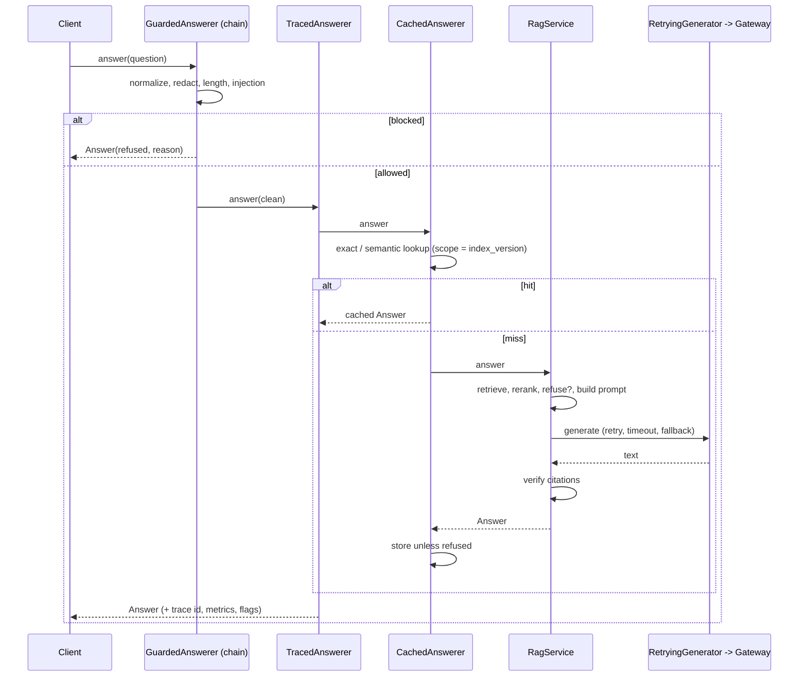
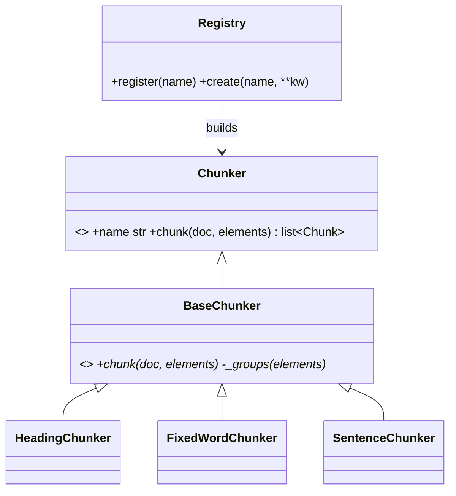
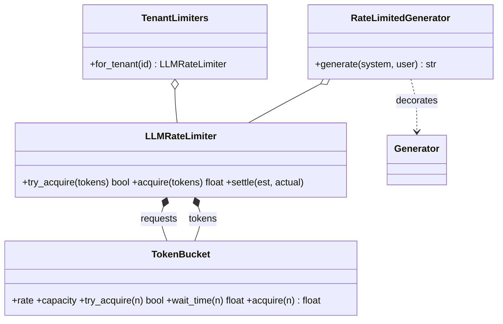
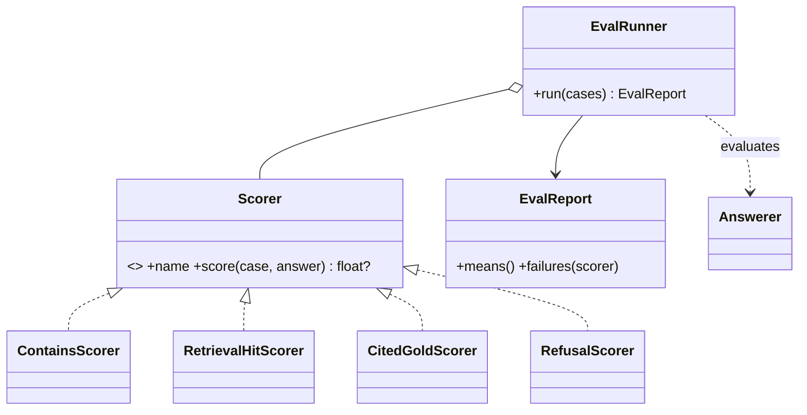
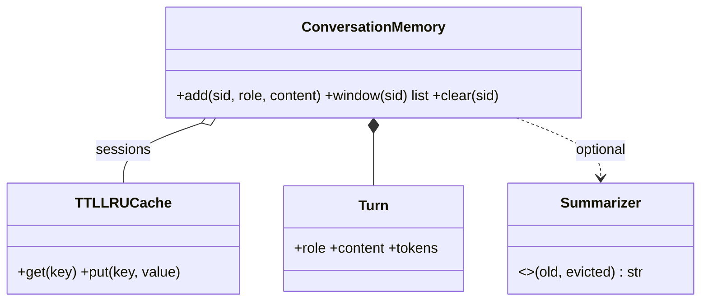
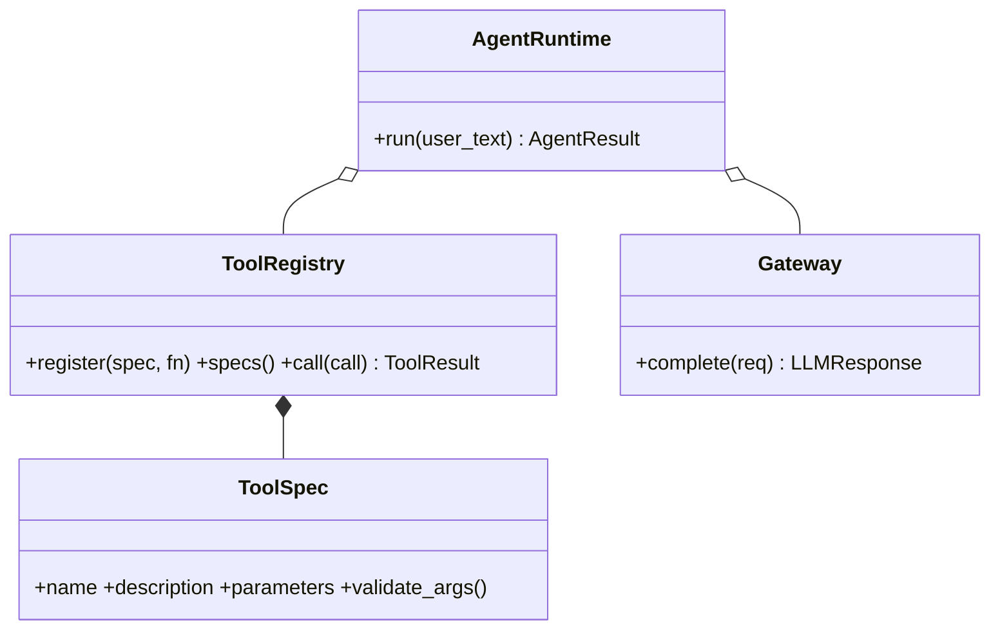
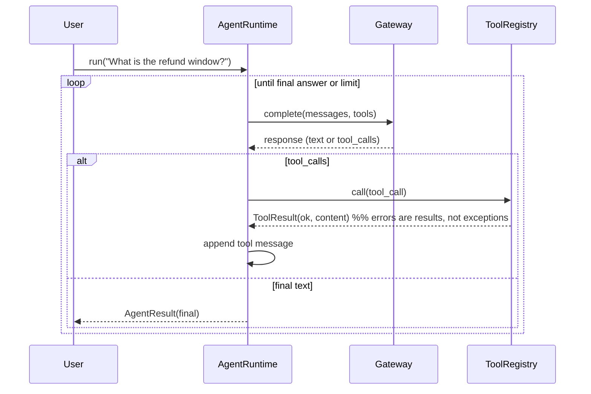

# Step 10 — LLD interview problems: six worked designs on top of ragkit

## The story so far
Steps 01-09 built `ragkit` piece by piece. An LLD round gives you 45-60 minutes, a whiteboard (or an editor) and a prompt like "design a rate limiter for an LLM API". You will not have ragkit, but you will have its *patterns*: Protocols, value objects, Strategy, Decorator, injectable clocks, error taxonomy.

## The pain point
Candidates fail LLD rounds not for lack of knowledge but for lack of **structure**: they start coding the first class they think of, forget the failure cases, never draw a diagram, and cannot show the design is testable.

## The spark
Use the same seven-step frame every time: **1 requirements** (functional, non-functional, out of scope), **2 entities** (nouns -> value objects), **3 interfaces** (verbs -> Protocols), **4 class diagram**, **5 sequence diagram** of the main flow and the failure path, **6 edge cases**, **7 tests** (what you would assert, with fakes). Each problem below follows it and points to running code.

## Goal
Practise the frame on six problems (RAG service, chunker library, LLM rate limiter, eval harness, conversation memory, tool-calling agent runtime), run a mini-demo of each, and be able to reproduce any of them on a whiteboard in 45 minutes.

## The theory (read this before the interview)
### The seven-step frame (say it out loud at the start of an interview)
1. **Clarify requirements**: functional (what), non-functional (latency, scale, cost, safety), assumptions and what is out of scope. Ask 3-5 questions, then restate.
2. **Entities**: underline the nouns; make them frozen dataclasses; decide identities (content hash vs uuid).
3. **Interfaces**: the verbs between entities; one small Protocol each; name the **seams** where things will change (model, store, clock).
4. **Class diagram**: boxes for interfaces, implementations and the orchestrator; arrows for implements / depends-on.
5. **Sequence diagram**: the happy path, then the failure path (timeout, refusal, invalid output).
6. **Edge cases and failure handling**: empty input, oversized input, duplicates, concurrency, partial failure, abuse, privacy.
7. **Tests**: unit tests with fakes, a contract test per Protocol, property tests (round trip, idempotency), one end-to-end test.
Close with **trade-offs** (what you would do with more time) and **extensions**.

---
## Problem 1: Design a RAG service
**Requirements.** Functional: ingest documents (add/update/delete), answer questions with citations, refuse when evidence is weak, filter by tenant. Non-functional: p95 < 2 s, swap vector DB and model without code changes, observable, survives provider failures, incremental re-index. Out of scope: UI, auth provider.
**Entities.** `Document`, `Chunk`, `Embedding`, `SearchHit`, `Citation`, `Answer` (step 02).
**Interfaces.** `Loader`, `Parser`, `Chunker`, `Embedder`, `VectorStore`, `Retriever`, `Reranker`, `Generator`, `Answerer` (steps 03-04). Policies: `ScoreThresholdPolicy`, `CitationVerifier`, `PromptBuilder`.
**Class diagram.** See the full ragkit diagram in the [module README](../README.md#the-full-ragkit-class-diagram). The core: `RagService` depends on six Protocols; decorators (`CachedAnswerer`, `TracedAnswerer`, `GuardedAnswerer`, `RetryingGenerator`) wrap Protocol implementations; `build_system(config)` is the composition root.
**Sequence (with cross-cutting layers).**

**Edge cases.** empty KB; document edited while queries run (swap the index by alias, never mutate in place); unchanged re-ingest; provider down (fallback, then an honest error); prompt injection in a document (delimiters, rule 3, ingest filtering); invalid citation (log, retry once or refuse); tenant isolation (filter in the store, **scope in the cache key**); huge question (length guard); duplicate chunks (id dedupe); embedding model change (index version rebuild).
**Tests.** Unit tests with `HashingEmbedder`, `ScriptedProvider`, `FakeClock`; store contract test on both stores; idempotent-ingest test; refusal-does-not-call-generator test; round-trip serialisation; end-to-end on the KB with expected citations; an eval-harness regression gate.

---
## Problem 2: Design a document chunker library
**Requirements.** Several strategies (heading, fixed window with overlap, sentence packing, later semantic), chosen by name from config; deterministic chunk ids; metadata preserved; a max size in words or tokens; no cut sentences where possible; safe on weird input.
**Entities.** `Element`, `Chunk`; config value `ChunkerConfig(type, params)`.
**Interfaces.** `Chunker.chunk(doc, elements) -> list[Chunk]` plus `name` (the index-version key). Extension: **Registry** `CHUNKERS.register('semantic')`; shared skeleton as **Template Method** (`BaseChunker.chunk` + `_groups`).
**Class diagram.**

**Edge cases.** empty document; a single sentence longer than the limit (hard-split by words, say so); tables and code blocks (never split inside; own chunk); overlap >= size (reject in the constructor); identical paragraphs (dedupe by id); Unicode and non-English (word counts are not token counts: use the real tokenizer for the limit); chunk positions stable; edits at the top (heading chunkers keep ids; fixed windows do not, see step 03).
**Tests.** every chunk non-empty and under the limit; concatenation covers all content (no loss) for non-overlapping strategies; ids deterministic across runs; overlap windows share exactly `overlap` words; `ValueError` for bad config; registry unknown-name error lists options.

---
## Problem 3: Design a rate limiter for an LLM API
**Requirements.** Enforce **requests per minute and tokens per minute**, per tenant; allow bursts; fair between tenants; callers can wait (blocking) or be rejected (non-blocking); the token count is unknown until the response, so reserve then settle.
**Entities.** `LLMRateLimiter(rpm, tpm)`, `TokenBucket(rate, capacity)`, `TenantLimiters`.
**Interfaces.** `try_acquire(est_tokens) -> bool`, `acquire(est_tokens) -> waited_seconds`, `settle(estimated, actual)`; injectable `clock`.
**Class diagram.**

**Sequence.** `generate` -> estimate tokens (input + max output) -> `acquire` (wait on the bucket via the clock) -> call model -> `settle(est, actual)` refunds the over-reservation.
**Edge cases.** request larger than the bucket capacity (can never succeed: error, do not loop); check BOTH buckets before spending either (else a rejected request still burns a request token); monotonic clock (not wall clock); refunds cannot exceed capacity; thundering herd on refill (add jitter to waits); noisy neighbour (per-tenant buckets); **distributed** deployment: state in Redis with an atomic Lua script (or a gateway that serialises), clock skew; provider 429 still possible (combine with retry, step 06).
**Tests.** burst then deny; refill after `advance`; RPM and TPM independent; failed acquire spends nothing; settle refund; tenant isolation; 40 calls at 30 rpm wait exactly 20 s on the fake clock.

---
## Problem 4: Design an LLM eval harness
**Requirements.** Run a labelled dataset through any `Answerer`, compute several metrics, report aggregates and failing cases, compare two runs to find **regressions**, usable as a CI gate, tolerant of crashes.
**Entities.** `EvalCase(id, question, expected, gold_chunk_ids, answerable)`, `EvalReport(rows)`.
**Interfaces.** `Scorer.score(case, answer) -> float | None` (None = not applicable); `EvalRunner(answerer, scorers).run(cases)`; `regressions(base, new, scorer)`.
**Class diagram.**

**Edge cases.** a case that crashes (row with `error=1`, run continues); scorers that do not apply (None, excluded from the mean); non-determinism (temperature 0, fixed seeds, repeat k times and report variance); dataset leakage (do not tune on the test set); LLM-as-judge bias (position, verbosity; calibrate against humans); metric choice for refusals (both false accepts and false refusals); versioned datasets; cost of the eval itself.
**Tests.** known fake answerer -> exact expected means; crash handled; regression listing; scorers return None where expected.

---
## Problem 5: Design a conversation memory store
**Requirements.** Keep per-session history for a chatbot within a token budget, summarise what is dropped, isolate sessions/tenants, expire idle sessions, bound memory.
**Entities.** `Turn(role, content, tokens)`, session record `{turns, summary}`.
**Interfaces.** `add(session, role, content)`, `window(session) -> messages`, `clear(session)`; `summarizer(old_summary, evicted_turns) -> str` injected; storage in a TTL+LRU cache (step 07), swappable for Redis/DB.
**Class diagram.**

**Sequence.** `add` -> append `Turn` -> while total tokens > budget and more than one turn: pop the oldest into `evicted` -> `summarizer(summary, evicted)` -> write back (refreshes TTL). `window` -> optional system message with the summary + the kept turns.
**Edge cases.** a single turn bigger than the budget (keep it; never return an empty window); concurrent writes to one session (lock or optimistic version, since read-modify-write races); summary drift/compounding errors (summarise from the previous summary + evicted turns, keep facts such as names and ids verbatim); PII retention and deletion (`clear`); tenant isolation (key = tenant + session); persistence (TTL cache is in-process: use Redis for multi-instance); token counting by the real tokenizer.
**Tests.** trimming keeps the newest; summary created from evicted turns; other session unaffected; TTL expiry on the fake clock; LRU eviction of sessions; oversized single turn kept.

---
## Problem 6: Design a tool-calling agent runtime
**Requirements.** Let a model call registered tools with validated arguments, feed results back, and stop safely: bounded steps, loop detection, errors visible to the model, no unhandled exceptions, observable, side-effect tools gated.
**Entities.** `ToolSpec`, `ToolCall`, `ToolResult(ok, content)`, `AgentResult(text, stopped, steps, transcript)`.
**Interfaces.** `ToolRegistry.register(spec, fn)`, `.call(ToolCall) -> ToolResult` (never raises); `AgentRuntime.run(user_text)`; model access through the `Gateway`.
**Class diagram.**

**Sequence.**

**Edge cases.** unknown tool and bad arguments (return an error *as an observation* so the model can recover); a tool that raises (caught, reported); **loop** (same tool + same args twice -> stop); step limit; parallel tool calls (all results matched by id); **prompt injection through tool output** (treat as data, never as instructions); permissions (read-only tools run freely; side-effect tools need confirmation or an allow-list); per-tool timeouts; huge tool outputs (truncate); cost budget (gateway meter).
**Tests.** tool then final; each error type fed back; loop guard; step limit; arguments coerced (`'5'` -> 5); transcript content.

## Same thing, different names
| Term you will hear | Also called / near-synonyms | Exactly the same? | Difference in one line |
|---|---|---|---|
| LLD interview / machine-coding round | object-oriented design round, design-a-class-library | Mostly | Machine-coding wants running, tested code in ~90 minutes; plain LLD is a whiteboard/diagram discussion. |
| Requirements -> entities -> interfaces | domain modelling, noun/verb analysis | Close | The standard way to derive classes from a prompt. |
| Rate limiter vs throttle vs quota | token bucket, leaky bucket, fixed window | No | Limiter = enforcement mechanism; throttle = slowing instead of rejecting; quota = a larger-period allowance (per month). |
| Eval harness | evaluation framework, benchmark runner, regression suite | Close | Harness = the code that runs cases and scorers; benchmark = a fixed dataset; regression suite = cases you must not break. |
| Conversation memory | chat history, session store, context window management | Close | Short-term memory = recent turns in the prompt; long-term memory = retrieved notes about the user (a RAG over past chats). |
| Agent runtime | agent loop, orchestrator, harness, executor | Mostly | The loop that alternates model calls and tool calls (module 08). |
| Composition root | main(), wiring module, DI container | Close | The one place where concrete classes are chosen and connected. |

## Run it
```bash
# from this step folder
HF_HUB_OFFLINE=1 python main.py
# or from the repo root
HF_HUB_OFFLINE=1 .venv/bin/python 20_llm_system_lld/10_lld_interview_problems/main.py
```


## Code, step by step
Five files: the demo `main.py`, then the four modules the problems introduce: `ragkit/ratelimit.py`, `ragkit/memory.py`, `ragkit/evalkit.py`, `ragkit/agent.py`. Problems 1 and 2 reuse earlier modules (walked in steps 02-09). Every block is listed.

#### Walking `main.py`

### 1. Header docstring  (`main.py` lines 1–17)
```python
"""
GOAL:  Six worked LLD problems (see WALKTHROUGH.md for requirements -> entities -> interfaces -> diagrams -> edge cases),
       with a running mini-demo of each on top of ragkit: (1) a RAG service wired from config with cache, retry, tracing;
       (2) a chunker library; (3) an LLM rate limiter; (4) an eval harness on module 14's 29 questions;
       (5) a conversation memory store; (6) a tool-calling agent runtime.

RUN (from this step folder):  python main.py
RUN (from repo root):         HF_HUB_OFFLINE=1 .venv/bin/python 20_llm_system_lld/10_lld_interview_problems/main.py
EXPECTED OUTPUT (shortened):
    1) service: ... cache=miss then exact | retries=1 | trace spans ..
    2) chunker library: heading=.. fixed=.. sentence=..
    3) rate limiter: 60 allowed in burst, then waits
    4) eval: contains=.. gold_in_context=.. refusal_correct=..
    5) memory: window trimmed ... summary kept
    6) agent: step 1 search_docs -> ok ... step 2 final answer
NEEDS: ragkit + module 14 data. No models (HashingEmbedder), no network.
"""
```
- **In simple words:** What the file shows.
- **Exactly:** Six numbered mini-demos.
- **Why it is here:** Orientation.

### 2. Imports  (`main.py` lines 18–41)
```python
import json
import random
import sys
from pathlib import Path

sys.path.insert(0, str(Path(__file__).resolve().parents[1]))
from pydantic import BaseModel

from ragkit.agent import AgentRuntime, ToolRegistry
from ragkit.cache import CachedAnswerer, TTLLRUCache
from ragkit.chunking import FixedWordChunker, HeadingChunker, SentenceChunker
from ragkit.evalkit import (CitedGoldScorer, ContainsScorer, EvalCase, EvalRunner, RefusalScorer, RetrievalHitScorer,
                            regressions)
from ragkit.factory import CHUNKERS, build_system
from ragkit.gateway import Gateway, ScriptedProvider, ToolCall, ToolSpec
from ragkit.ingest import DirectoryLoader, MarkdownParser
from ragkit.memory import ConversationMemory
from ragkit.observability import Metrics, TracedAnswerer, Tracer
from ragkit.ratelimit import LLMRateLimiter, RateLimitedGenerator
from ragkit.resilience import RetryingGenerator, RetryPolicy, TransientError
from ragkit.testing import FakeClock

ROOT = Path(__file__).resolve().parents[2]
KB = ROOT / "14_rag_and_retrieval" / "data" / "kb"
```
- **In simple words:** One import per problem.
- **Exactly:** Agent, cache, chunkers, eval, factory, gateway, memory, observability, rate limiter, resilience, fakes.
- **Why it is here:** A whole system from reusable parts.

### 3. Problem 1: build the RAG service from config  (`main.py` lines 43–46)
```python
# ======================= 1. Design a RAG service ==================================================================
system = build_system({"chunker": {"type": "heading", "max_words": 80}}, DirectoryLoader(KB))
system.pipeline.run()
retries = []
```
- **In simple words:** Create the system and note where the pieces will be wrapped.
- **Exactly:** `build_system({'chunker': {'type': 'heading', 'max_words': 80}}, DirectoryLoader(KB))`; `pipeline.run()`.
- **Why it is here:** Composition root.

### 4. Make the first LLM call fail once, then retry  (`main.py` lines 47–57)
```python
real_gen = system.service.generator
class Wrapped:                                                           # fails once on cue, then delegates
    def __init__(self):
        self.first = True
    def generate(self, s, u):
        if self.first:
            self.first = False
            raise TransientError("503")
        return real_gen.generate(s, u)
system.service.generator = RetryingGenerator(Wrapped(), RetryPolicy(max_attempts=3), FakeClock(), random.Random(1),
                                             on_retry=lambda n, e, d: retries.append(n))
```
- **In simple words:** A wrapper that raises a 503 the first time.
- **Exactly:** `Wrapped.generate` raises `TransientError('503')` once, then delegates; `RetryingGenerator(Wrapped(), RetryPolicy(max_attempts=3), FakeClock(), random.Random(1), on_retry=...)`.
- **Why it is here:** Shows resilience without a real network.

### 5. Cache and trace around the service; ask twice  (`main.py` lines 58–63)
```python
tracer, metrics = Tracer(), Metrics()
app = TracedAnswerer(CachedAnswerer(system.service, TTLLRUCache(64, 600), scope=lambda: system.pipeline.index_version),
                     tracer, metrics)
for q in ["How many days do I have to get a refund?", "How many days do I have to get a refund?"]:
    a = app.answer(q)
    print(f"1) service: {a.text[:58]}... cache={a.meta['cache']} retries so far={len(retries)} | root spans={sum(s.name == 'rag.answer' for s in tracer.spans)}")
```
- **In simple words:** Layer the decorators and send the same question twice.
- **Exactly:** `TracedAnswerer(CachedAnswerer(service, TTLLRUCache(64, 600), scope=index_version), tracer, metrics)`. Output: first `cache=miss retries so far=1 | root spans=1`; second `cache=exact retries so far=1 | root spans=2` (no new retry: no LLM call).
- **Why it is here:** Four earlier steps working together.

### 6. Problem 2: chunker library  (`main.py` lines 65–71)
```python
# ======================= 2. Design a document chunker library ====================================================
doc = next(d for d in DirectoryLoader(KB).load() if d.source == "refunds_and_returns.md")
elements = MarkdownParser().parse(doc)
for name in CHUNKERS.names():
    ch = CHUNKERS.create(name)
    chunks = ch.chunk(doc, elements)
    print(f"2) chunker {ch.name:28s} -> {len(chunks)} chunks, longest {max(len(c.text.split()) for c in chunks)} words")
```
- **In simple words:** Run every registered chunker on the refunds document.
- **Exactly:** `CHUNKERS.names()` -> fixed, heading, sentence. Output: fixed(size=50,overlap=10) 4 chunks (longest 50 words); heading(max_words=120) 4 chunks (longest 47); sentence(max_words=40) 5 chunks (longest 37).
- **Why it is here:** A library = Protocol + registry + shared skeleton.

### 7. Problem 3: LLM rate limiter, burst  (`main.py` lines 73–77)
```python
# ======================= 3. Design a rate limiter for an LLM API ===============================================
clock = FakeClock()
limiter = LLMRateLimiter(rpm=60, tpm=6000, clock=clock)
allowed = sum(limiter.try_acquire(50) for _ in range(100))
print(f"3) rate limiter rpm=60 tpm=6000: {allowed} of 100 instant requests allowed (burst), tokens left {limiter.tokens.tokens:.0f}")
```
- **In simple words:** 100 instant requests of 50 tokens against 60 rpm / 6000 tpm.
- **Exactly:** `60 of 100 instant requests allowed (burst)`, `tokens left 3000` (60 x 50 = 3000 used of 6000). The 61st request was stopped by the *request* bucket, not the token bucket.
- **Why it is here:** Two independent limits.

### 8. Rate limiter as a Decorator, with waiting  (`main.py` lines 78–84)
```python
class Echo:
    def generate(self, s, u):
        return "ok"
rl = RateLimitedGenerator(Echo(), LLMRateLimiter(rpm=30, tpm=100_000, clock=clock), max_output_tokens=10)
for _ in range(40):
    rl.generate("s", "u")
print(f"   40 sequential calls at 30 rpm: simulated waiting {rl.total_wait:.1f} s (no real sleeping)")
```
- **In simple words:** 40 sequential calls at 30 rpm.
- **Exactly:** `RateLimitedGenerator(Echo(), LLMRateLimiter(rpm=30, tpm=100_000, clock), max_output_tokens=10)`; `simulated waiting 20.0 s`: 30 allowed instantly, the other 10 at one per 2 s.
- **Why it is here:** Waiting is simulated by the fake clock, so the demo is instant.

### 9. Problem 4: eval on module 14's 29 questions  (`main.py` lines 86–94)
```python
# ======================= 4. Design an LLM eval harness ============================================================
by_key = {f"{Path(c.metadata['source']).stem}#{c.section}": c.chunk_id for c in system.store.all_chunks()}
raw = json.loads((ROOT / "14_rag_and_retrieval" / "data" / "eval_questions.json").read_text())
cases = [EvalCase(r["id"], r["question"], r.get("answer") if r["gold"] else None,
                  tuple(by_key[g] for g in r["gold"]), bool(r["gold"])) for r in raw]
scorers = [ContainsScorer(), RetrievalHitScorer(), CitedGoldScorer(), RefusalScorer()]
base = EvalRunner(system.service, scorers).run(cases)
print("4) eval on", len(cases), "questions:", {k: round(v, 2) for k, v in base.means().items() if v is not None})
print("   cases where the gold chunk never reached the prompt:", base.failures("gold_in_context"))
```
- **In simple words:** Map gold ids to our chunk ids, build cases and scorers, run.
- **Exactly:** Cases from `eval_questions.json` (24 answerable, 5 not); `by_key` maps `'doc#Section'` to chunk ids. Result: `contains 0.5, cites_gold 0.71, gold_in_context 0.75, refusal_correct 0.72`; 6 cases where gold never reached the prompt: `q04 q07 q11 q18 q22 q23`.
- **Why it is here:** A baseline with real numbers for the offline pipeline (hashing embedder + overlap reranker).

### 10. A 'change' gated by the harness  (`main.py` lines 95–99)
```python
system.service.refusal.min_score = 0.6                                    # a "change" we want to gate in CI
new = EvalRunner(system.service, scorers).run(cases)
print("   after raising refusal threshold to 0.6 -> regressions on 'contains':", regressions(base, new, "contains")[:6],
      "| refusal_correct", round(base.mean("refusal_correct"), 2), "->", round(new.mean("refusal_correct"), 2))
system.service.refusal.min_score = 0.3
```
- **In simple words:** Raise the refusal threshold and compare runs.
- **Exactly:** `regressions(base, new, 'contains')` -> `['q01', 'q08', 'q17', ...]`; `refusal_correct` 0.72 -> 0.59. The change makes the system refuse more answerable questions: a CI gate would block it.
- **Why it is here:** Regressions are the point of the harness.

### 11. Problem 5: conversation memory  (`main.py` lines 101–110)
```python
# ======================= 5. Design a conversation memory store =====================================================
mem = ConversationMemory(max_tokens=30, clock=FakeClock(),
                         summarizer=lambda old, ev: (old + " " if old else "") + "earlier: " + "; ".join(t.content[:25] for t in ev))
for i, text in enumerate(["I want to return my tea", "Which order is it?", "Order 1001, the masala blend",
                          "Is it sealed?", "Yes it is sealed", "Then you can get a refund"]):
    mem.add("sess-1", "user" if i % 2 == 0 else "assistant", text)
print("5) memory window for sess-1:")
for m in mem.window("sess-1"):
    print("     ", m["role"], "|", m["content"])
print("   other session is empty:", mem.window("sess-2") == [])
```
- **In simple words:** Six turns into a 30-token window with a summariser.
- **Exactly:** Window: a system message `Summary of earlier conversation: earlier: I want to return my tea earlier: Which order is it?` followed by the 4 newest turns; `sess-2` is empty.
- **Why it is here:** Old turns are folded into a summary, new ones stay verbatim.

### 12. Problem 6: agent runtime and tools  (`main.py` lines 112–120)
```python
# ======================= 6. Design a tool-calling agent runtime ====================================================
class SearchArgs(BaseModel):
    query: str
    top_k: int = 2
def search_docs(query, top_k):
    hits = system.service.retriever.retrieve(query, top_k)
    return " | ".join(f"{h.chunk.section}: {h.chunk.text[:60]}" for h in hits)
tools = ToolRegistry()
tools.register(ToolSpec.from_model("search_docs", "Search the knowledge base", SearchArgs), search_docs)
```
- **In simple words:** Register a search tool backed by the RAG retriever.
- **Exactly:** `SearchArgs(query: str, top_k: int = 2)`; `search_docs` returns `'Refund window: Refunds at Chai Kitchen are issued within 9 days...'`-style strings.
- **Why it is here:** A tool is just a function plus a schema.

### 13. Run the agent on a scripted model  (`main.py` lines 121–129)
```python
script = [("", [ToolCall("c1", "search_docs", {"query": "refunds within days of delivery"})]),
          ("", [ToolCall("c2", "search_docs", {"top_k": 1})]),                     # bad arguments: the model sees the error
          ("", [ToolCall("c3", "calculator", {"x": 1})]),                            # unknown tool
          "Refunds are issued within 9 days of delivery."]
agent = AgentRuntime(Gateway({"default": [ScriptedProvider("scripted", script)]}), tools, max_steps=6)
res = agent.run("What is the refund window?")
print(f"6) agent stopped={res.stopped} after {res.steps} steps -> {res.text!r}")
for line in res.transcript:
    print("     ", line[:140])
```
- **In simple words:** The 'model' calls the tool, then calls it wrongly, then calls an unknown tool, then answers.
- **Exactly:** `stopped=final after 4 steps`; transcript: step 1 ok, step 2 `ERROR: invalid arguments: Field required at ('query',)`, step 3 `ERROR: unknown tool 'calculator'; available: ['search_docs']`, step 4 final answer.
- **Why it is here:** Errors become observations the model can react to.

### 14. Exercises  (`main.py` lines 131–133)
```python
# TRY IT: in problem 4 set refusal min_score to 0.0 and compare refusal_correct: which unanswerable questions leak through?
# TRY IT: in problem 6 use max_steps=2: read the 'max_steps' stop reason.
# BREAK IT: in problem 1 use RetryPolicy(max_attempts=1): the first TransientError reaches the caller. Where should it be caught?
```
- **In simple words:** Things to try.
- **Exactly:** Comment lines.
- **Why it is here:** See exercises.md.


#### Walking `ragkit/ratelimit.py`

### 15. ratelimit.py header and imports  (`ragkit/ratelimit.py` lines 1–5)
```python
"""ratelimit.py -- an LLM-API rate limiter: requests/min AND tokens/min, per tenant (step 10, problem 3)."""
from __future__ import annotations

from .query import WordTokenCounter
from .resilience import SystemClock, TokenBucket
```
- **In simple words:** An LLM-API rate limiter.
- **Exactly:** Imports `TokenBucket` and `SystemClock` from step 06 and `WordTokenCounter` from step 04.
- **Why it is here:** Reuse beats rewrite.

### 16. LLMRateLimiter: two buckets  (`ragkit/ratelimit.py` lines 8–14)
```python
class LLMRateLimiter:
    """LLM providers limit BOTH requests per minute (RPM) and tokens per minute (TPM). Both buckets must have room."""

    def __init__(self, rpm: int, tpm: int, clock=None):
        self.clock = clock or SystemClock
        self.requests = TokenBucket(rpm / 60, rpm, self.clock)       # refill rate per second, burst = one minute's worth
        self.tokens = TokenBucket(tpm / 60, tpm, self.clock)
```
- **In simple words:** One bucket for requests per minute, one for tokens per minute.
- **Exactly:** `requests = TokenBucket(rpm/60, rpm)`, `tokens = TokenBucket(tpm/60, tpm)`: refill per second, burst = one minute's allowance.
- **Why it is here:** Providers enforce both limits.

### 17. try_acquire: check both, then spend both  (`ragkit/ratelimit.py` lines 16–19)
```python
    def try_acquire(self, est_tokens: int) -> bool:
        if self.requests.wait_time(1) > 0 or self.tokens.wait_time(est_tokens) > 0:
            return False                                              # check BOTH first so we never spend one bucket for nothing
        return self.requests.try_acquire(1) and self.tokens.try_acquire(est_tokens)
```
- **In simple words:** Reject without side effects if either is short.
- **Exactly:** `if requests.wait_time(1) > 0 or tokens.wait_time(est) > 0: return False`; only then `try_acquire` on both.
- **Why it is here:** Spending one bucket and then failing on the other leaks capacity.

### 18. acquire: wait until allowed  (`ragkit/ratelimit.py` lines 21–27)
```python
    def acquire(self, est_tokens: int) -> float:
        waited = 0.0
        while not self.try_acquire(est_tokens):
            w = max(self.requests.wait_time(1), self.tokens.wait_time(est_tokens), 1e-6)
            self.clock.sleep(w)
            waited += w
        return waited
```
- **In simple words:** Sleep the longer of the two waits and retry.
- **Exactly:** `w = max(requests.wait_time(1), tokens.wait_time(est), 1e-6)`; `clock.sleep(w)`; returns total waited.
- **Why it is here:** A tiny floor avoids a zero-length busy loop.

### 19. settle: refund over-reservation  (`ragkit/ratelimit.py` lines 29–32)
```python
    def settle(self, estimated: int, actual: int) -> None:
        """After the call we know the real token count: give back what we over-reserved."""
        if actual < estimated:
            self.tokens.tokens = min(self.tokens.capacity, self.tokens.tokens + (estimated - actual))
```
- **In simple words:** We reserved input + max output; the real count was smaller.
- **Exactly:** `tokens.tokens = min(capacity, tokens + (estimated - actual))` when `actual < estimated`.
- **Why it is here:** Without settling, the limiter is permanently too strict.

### 20. TenantLimiters: one limiter per tenant  (`ragkit/ratelimit.py` lines 35–45)
```python
class TenantLimiters:
    """One limiter per tenant, created on first use, so one noisy tenant cannot starve the others."""

    def __init__(self, rpm: int, tpm: int, clock=None):
        self.rpm, self.tpm, self.clock = rpm, tpm, clock
        self._by: dict[str, LLMRateLimiter] = {}

    def for_tenant(self, tenant: str) -> LLMRateLimiter:
        if tenant not in self._by:
            self._by[tenant] = LLMRateLimiter(self.rpm, self.tpm, self.clock)
        return self._by[tenant]
```
- **In simple words:** Created on first use.
- **Exactly:** dict `tenant -> LLMRateLimiter` with the same rpm/tpm.
- **Why it is here:** A noisy tenant cannot consume the others' capacity.

### 21. RateLimitedGenerator: constructor  (`ragkit/ratelimit.py` lines 48–54)
```python
class RateLimitedGenerator:
    """Decorator: wait for capacity, call, settle the token estimate."""

    def __init__(self, inner, limiter: LLMRateLimiter, max_output_tokens: int = 200):
        self.inner, self.limiter, self.max_out = inner, limiter, max_output_tokens
        self.count = WordTokenCounter().count
        self.total_wait = 0.0
```
- **In simple words:** A Decorator over any Generator.
- **Exactly:** Holds `inner`, `limiter`, `max_output_tokens`, a token counter and `total_wait`.
- **Why it is here:** Same Protocol in and out.

### 22. RateLimitedGenerator.generate  (`ragkit/ratelimit.py` lines 56–61)
```python
    def generate(self, system: str, user: str) -> str:
        est = self.count(system + " " + user) + self.max_out         # reserve worst case: input + max output
        self.total_wait += self.limiter.acquire(est)
        out = self.inner.generate(system, user)
        self.limiter.settle(est, self.count(system + " " + user) + self.count(out))
        return out
```
- **In simple words:** Reserve, call, settle.
- **Exactly:** `est = count(system + user) + max_out`; `acquire(est)`; `inner.generate`; `settle(est, count(prompt) + count(output))`.
- **Why it is here:** Worst-case reservation, then the truth.


#### Walking `ragkit/memory.py`

### 23. memory.py header and imports  (`ragkit/memory.py` lines 1–8)
```python
"""memory.py -- conversation memory store: per-session window with a token budget + optional summary (step 10, problem 5)."""
from __future__ import annotations

from dataclasses import dataclass
from typing import Callable

from .cache import MISS, TTLLRUCache
from .query import WordTokenCounter
```
- **In simple words:** A conversation memory store.
- **Exactly:** Imports the TTL+LRU cache from step 07 and the token counter.
- **Why it is here:** Sessions are exactly a TTL+LRU cache problem.

### 24. Turn: one message with its token count  (`ragkit/memory.py` lines 11–15)
```python
@dataclass(frozen=True, slots=True)
class Turn:
    role: str
    content: str
    tokens: int
```
- **In simple words:** Role, content, tokens.
- **Exactly:** Frozen, slotted dataclass.
- **Why it is here:** Token counts computed once, not on every trim.

### 25. ConversationMemory: constructor  (`ragkit/memory.py` lines 18–26)
```python
class ConversationMemory:
    """Sessions live in a TTL+LRU cache (idle sessions expire; at most `max_sessions` in memory).
    Each session keeps the newest turns that fit `max_tokens`; evicted turns are folded into a summary if a summariser is given."""

    def __init__(self, max_tokens: int = 200, max_sessions: int = 1000, ttl: float | None = 3600.0,
                 summarizer: Callable[[str, list[Turn]], str] | None = None, clock=None):
        self.max_tokens, self.summarizer = max_tokens, summarizer
        self.count = WordTokenCounter().count
        self._sessions = TTLLRUCache(max_sessions, ttl, clock)
```
- **In simple words:** Budget, session limits, optional summariser.
- **Exactly:** `max_tokens=200`, `max_sessions=1000`, `ttl=3600`; sessions live in `TTLLRUCache`.
- **Why it is here:** Idle sessions expire; memory is bounded.

### 26. _get: read a session or start an empty one  (`ragkit/memory.py` lines 28–30)
```python
    def _get(self, sid: str) -> dict:
        s = self._sessions.get(sid)
        return {"turns": [], "summary": ""} if s is MISS else s
```
- **In simple words:** Missing session -> new record.
- **Exactly:** `MISS` sentinel -> `{'turns': [], 'summary': ''}`.
- **Why it is here:** Callers never see `None`.

### 27. add: append a turn and trim  (`ragkit/memory.py` lines 32–37)
```python
    def add(self, sid: str, role: str, content: str) -> None:
        s = self._get(sid)
        s["turns"].append(Turn(role, content, self.count(content)))
        evicted: list[Turn] = []
        while len(s["turns"]) > 1 and sum(t.tokens for t in s["turns"]) > self.max_tokens:
            evicted.append(s["turns"].pop(0))                         # oldest first
```
- **In simple words:** Add, then drop the oldest while over budget.
- **Exactly:** Keeps at least one turn (`len(turns) > 1`), so a single oversized message is still kept; evicted turns collected oldest first.
- **Why it is here:** Never return an empty window.

### 28. add: summarise and save  (`ragkit/memory.py` lines 38–40)
```python
        if evicted and self.summarizer:
            s["summary"] = self.summarizer(s["summary"], evicted)
        self._sessions.put(sid, s)                                    # put = refresh TTL + mark recently used
```
- **In simple words:** Fold evicted turns into the running summary.
- **Exactly:** `summary = summarizer(old_summary, evicted)`; `sessions.put(sid, s)` (also refreshes TTL).
- **Why it is here:** The summariser is injected: an LLM call in production, a lambda in tests.

### 29. window: what goes into the prompt  (`ragkit/memory.py` lines 42–45)
```python
    def window(self, sid: str) -> list[dict]:
        s = self._get(sid)
        head = [{"role": "system", "content": f"Summary of earlier conversation: {s['summary']}"}] if s["summary"] else []
        return head + [{"role": t.role, "content": t.content} for t in s["turns"]]
```
- **In simple words:** Summary first, then recent turns.
- **Exactly:** `[{'role': 'system', 'content': 'Summary of earlier conversation: ...'}] + turns` as plain dicts.
- **Why it is here:** The shape most chat APIs expect.

### 30. clear: forget a session  (`ragkit/memory.py` lines 47–48)
```python
    def clear(self, sid: str) -> None:
        self._sessions._data.pop(sid, None)
```
- **In simple words:** Delete a session (privacy, 'new chat').
- **Exactly:** Pops the key from the cache's dict.
- **Why it is here:** Right-to-erasure requests need an explicit delete.


#### Walking `ragkit/evalkit.py`

### 31. evalkit.py header and imports  (`ragkit/evalkit.py` lines 1–7)
```python
"""evalkit.py -- a tiny LLM/RAG eval harness: cases, scorers, runner, regression compare (step 10, problem 4)."""
from __future__ import annotations

from dataclasses import dataclass, field
from typing import Protocol, Sequence

from .domain import Answer
```
- **In simple words:** A tiny eval harness.
- **Exactly:** Imports dataclasses and `Answer`.
- **Why it is here:** No dependency on how answers are produced.

### 32. EvalCase  (`ragkit/evalkit.py` lines 10–16)
```python
@dataclass(frozen=True, slots=True)
class EvalCase:
    id: str
    question: str
    expected: str | None = None                  # a string the answer should contain
    gold_chunk_ids: tuple[str, ...] = ()
    answerable: bool = True
```
- **In simple words:** One labelled question.
- **Exactly:** `id, question, expected, gold_chunk_ids, answerable`; `answerable=False` means the right behaviour is to refuse.
- **Why it is here:** Unanswerable cases test the refusal policy.

### 33. Scorer Protocol  (`ragkit/evalkit.py` lines 19–21)
```python
class Scorer(Protocol):
    name: str
    def score(self, case: EvalCase, answer: Answer) -> float | None: ...      # None = not applicable
```
- **In simple words:** The metric contract.
- **Exactly:** `name` and `score(case, answer) -> float | None`; `None` = not applicable.
- **Why it is here:** Adding a metric = adding a class.

### 34. ContainsScorer  (`ragkit/evalkit.py` lines 24–29)
```python
class ContainsScorer:
    name = "contains"
    def score(self, case, answer):
        if not case.answerable or case.expected is None:
            return None
        return float(case.expected.casefold() in answer.text.casefold())
```
- **In simple words:** Does the answer contain the expected string?
- **Exactly:** Case-insensitive `in`; skipped (None) for unanswerable cases or no expected text.
- **Why it is here:** A weak but cheap correctness proxy.

### 35. RefusalScorer  (`ragkit/evalkit.py` lines 32–35)
```python
class RefusalScorer:
    name = "refusal_correct"
    def score(self, case, answer):
        return float(answer.refused == (not case.answerable))
```
- **In simple words:** Did we refuse exactly when we should?
- **Exactly:** `1.0` if `answer.refused == (not case.answerable)`.
- **Why it is here:** Counts both false accepts and false refusals.

### 36. RetrievalHitScorer  (`ragkit/evalkit.py` lines 38–43)
```python
class RetrievalHitScorer:
    name = "gold_in_context"
    def score(self, case, answer):
        if not case.gold_chunk_ids:
            return None
        return float(any(g in answer.context_chunk_ids for g in case.gold_chunk_ids))
```
- **In simple words:** Was a gold chunk in the prompt?
- **Exactly:** Any gold id in `answer.context_chunk_ids`.
- **Why it is here:** Separates retrieval failures from generation failures.

### 37. CitedGoldScorer  (`ragkit/evalkit.py` lines 46–51)
```python
class CitedGoldScorer:
    name = "cites_gold"
    def score(self, case, answer):
        if not case.gold_chunk_ids:
            return None
        return float(any(c.chunk_id in case.gold_chunk_ids for c in answer.citations))
```
- **In simple words:** Did the answer cite a gold chunk?
- **Exactly:** Any citation's `chunk_id` in the gold ids.
- **Why it is here:** Grounding check.

### 38. EvalReport: rows and aggregates  (`ragkit/evalkit.py` lines 54–67)
```python
@dataclass
class EvalReport:
    rows: list[dict] = field(default_factory=list)

    def mean(self, scorer: str) -> float | None:
        vals = [r[scorer] for r in self.rows if r.get(scorer) is not None]
        return sum(vals) / len(vals) if vals else None

    def means(self) -> dict[str, float | None]:
        names = sorted({k for r in self.rows for k in r if k not in ("id",)})
        return {n: self.mean(n) for n in names}

    def failures(self, scorer: str) -> list[str]:
        return [r["id"] for r in self.rows if r.get(scorer) == 0.0]
```
- **In simple words:** A list of per-case score dicts.
- **Exactly:** `mean(scorer)` ignores `None`; `means()` for all scorers; `failures(scorer)` lists case ids with score 0.
- **Why it is here:** The failing cases are where you learn.

### 39. EvalRunner: constructor  (`ragkit/evalkit.py` lines 70–72)
```python
class EvalRunner:
    def __init__(self, answerer, scorers: Sequence[Scorer]):
        self.answerer, self.scorers = answerer, list(scorers)
```
- **In simple words:** An answerer and a list of scorers.
- **Exactly:** Any `Answerer` (service, cached, traced, a fake).
- **Why it is here:** Evaluate the *whole stack* you ship.

### 40. EvalRunner.run  (`ragkit/evalkit.py` lines 74–83)
```python
    def run(self, cases: Sequence[EvalCase]) -> EvalReport:
        rep = EvalReport()
        for c in cases:
            try:
                ans = self.answerer.answer(c.question)
            except Exception as exc:                                  # one crashing case must not abort the run
                rep.rows.append({"id": c.id, "error": 1.0, **{s.name: 0.0 for s in self.scorers}})
                continue
            rep.rows.append({"id": c.id, **{s.name: s.score(c, ans) for s in self.scorers}})
        return rep
```
- **In simple words:** Answer each case and score it.
- **Exactly:** A crash becomes a row with `error=1.0` and zeros; otherwise `{id, scorer: score...}`.
- **Why it is here:** One bad case must not hide the other 28.

### 41. regressions()  (`ragkit/evalkit.py` lines 86–89)
```python
def regressions(base: EvalReport, new: EvalReport, scorer: str) -> list[str]:
    """Case ids that passed in `base` but fail in `new` for this scorer -- what a CI gate should list."""
    old_ok = {r["id"] for r in base.rows if r.get(scorer) == 1.0}
    return [i for i in new.failures(scorer) if i in old_ok]
```
- **In simple words:** Cases that used to pass and now fail.
- **Exactly:** `old_ok` = ids with score 1.0 in `base`; returns `new.failures(scorer)` that are in `old_ok`.
- **Why it is here:** What a CI gate prints.


#### Walking `ragkit/agent.py`

### 42. agent.py header and imports  (`ragkit/agent.py` lines 1–10)
```python
"""agent.py -- a tool-calling agent runtime: registry, validated tool calls, step limit, loop guard (step 10, problem 6)."""
from __future__ import annotations

import json
from dataclasses import dataclass, field
from typing import Any, Callable

from pydantic import ValidationError

from .gateway import Gateway, LLMRequest, Message, Role, ToolCall, ToolSpec
```
- **In simple words:** A tool-calling runtime.
- **Exactly:** Imports pydantic `ValidationError`, gateway types.
- **Why it is here:** Built on the gateway (step 08).

### 43. ToolResult  (`ragkit/agent.py` lines 13–16)
```python
@dataclass(frozen=True)
class ToolResult:
    ok: bool
    content: str
```
- **In simple words:** Outcome of a tool call.
- **Exactly:** Frozen `(ok, content)`.
- **Why it is here:** Success and failure share one shape the model can read.

### 44. ToolRegistry: register and list  (`ragkit/agent.py` lines 19–27)
```python
class ToolRegistry:
    def __init__(self):
        self._tools: dict[str, tuple[ToolSpec, Callable[..., Any]]] = {}

    def register(self, spec: ToolSpec, fn: Callable[..., Any]) -> None:
        self._tools[spec.name] = (spec, fn)

    def specs(self) -> tuple[ToolSpec, ...]:
        return tuple(s for s, _ in self._tools.values())
```
- **In simple words:** Name -> (spec, function).
- **Exactly:** `register(spec, fn)`, `specs()` returns the tuple passed to the model.
- **Why it is here:** The registry is the allow-list of capabilities.

### 45. ToolRegistry.call: never raises  (`ragkit/agent.py` lines 29–41)
```python
    def call(self, call: ToolCall) -> ToolResult:
        """Never raises: every failure becomes a ToolResult the MODEL can read and react to."""
        if call.name not in self._tools:
            return ToolResult(False, f"unknown tool {call.name!r}; available: {sorted(self._tools)}")
        spec, fn = self._tools[call.name]
        try:
            args = spec.validate_args(call.arguments)
        except ValidationError as exc:
            return ToolResult(False, f"invalid arguments: {exc.errors()[0]['msg']} at {exc.errors()[0]['loc']}")
        try:
            return ToolResult(True, str(fn(**args)))
        except Exception as exc:                                      # tool bug / external failure
            return ToolResult(False, f"tool error: {type(exc).__name__}: {exc}")
```
- **In simple words:** Validate, run, and turn every failure into a result.
- **Exactly:** Unknown name -> `ToolResult(False, 'unknown tool ...; available: [...]')`; `spec.validate_args` failure -> `'invalid arguments: <msg> at <loc>'`; exception in the tool -> `'tool error: Type: msg'`; success -> `str(fn(**args))`.
- **Why it is here:** The model sees the error and can retry correctly.

### 46. AgentResult  (`ragkit/agent.py` lines 44–49)
```python
@dataclass
class AgentResult:
    text: str
    stopped: str                                                      # "final" | "max_steps" | "loop"
    steps: int
    transcript: list[str] = field(default_factory=list)
```
- **In simple words:** The run's outcome.
- **Exactly:** `text`, `stopped` (`'final'`, `'max_steps'`, `'loop'`), `steps`, `transcript`.
- **Why it is here:** Callers and tests can see *why* it stopped.

### 47. AgentRuntime: constructor  (`ragkit/agent.py` lines 52–55)
```python
class AgentRuntime:
    def __init__(self, gateway: Gateway, tools: ToolRegistry, model: str = "default", max_steps: int = 5,
                 system: str = "You may call tools. Reply with the final answer when done."):
        self.gateway, self.tools, self.model, self.max_steps, self.system = gateway, tools, model, max_steps, system
```
- **In simple words:** Gateway, tools, alias, step limit, system prompt.
- **Exactly:** `max_steps=5`.
- **Why it is here:** A hard cap is the last line of defence against runaway cost.

### 48. AgentRuntime.run: set up  (`ragkit/agent.py` lines 57–60)
```python
    def run(self, user_text: str) -> AgentResult:
        messages = [Message(Role.USER, user_text)]
        seen: set[tuple[str, str]] = set()
        log: list[str] = []
```
- **In simple words:** Start with the user's message; remember seen calls.
- **Exactly:** `messages = [Message(USER, text)]`; `seen` set of `(tool, canonical-args-json)`.
- **Why it is here:** State is local to one run.

### 49. run: ask the model  (`ragkit/agent.py` lines 61–66)
```python
        for step in range(1, self.max_steps + 1):
            resp = self.gateway.complete(LLMRequest(tuple(messages), self.model, self.system, tools=self.tools.specs()))
            if not resp.tool_calls:
                log.append(f"step {step}: final answer")
                return AgentResult(resp.text, "final", step, log)
            messages.append(Message(Role.ASSISTANT, resp.text or f"(calling {resp.tool_calls[0].name})"))
```
- **In simple words:** One model call per step, tools attached.
- **Exactly:** `gateway.complete(LLMRequest(messages, model, system, tools=registry.specs()))`; no tool calls -> final `AgentResult(..., 'final')`.
- **Why it is here:** The model decides when it is done.

### 50. run: loop guard and tool execution  (`ragkit/agent.py` lines 67–75)
```python
            for call in resp.tool_calls:
                sig = (call.name, json.dumps(call.arguments, sort_keys=True))
                if sig in seen:                                       # same tool + same args again: the model is stuck
                    log.append(f"step {step}: repeated call {call.name} -> stop")
                    return AgentResult("stopped: repeated identical tool call", "loop", step, log)
                seen.add(sig)
                result = self.tools.call(call)
                log.append(f"step {step}: {call.name}({call.arguments}) -> {'ok' if result.ok else 'ERROR'}: {result.content}")
                messages.append(Message(Role.TOOL, f"[tool_result {call.name}] {result.content}"))
```
- **In simple words:** Run each requested tool once.
- **Exactly:** `sig = (name, json.dumps(args, sort_keys=True))`; if seen -> stop with `'loop'`; else `registry.call`, log, append a `Message(TOOL, '[tool_result name] ...')`.
- **Why it is here:** Identical repeated calls mean the model is stuck.

### 51. run: step limit  (`ragkit/agent.py` lines 76–76)
```python
        return AgentResult("stopped: step limit reached", "max_steps", self.max_steps, log)
```
- **In simple words:** Give up after max_steps.
- **Exactly:** Returns `stopped='max_steps'`.
- **Why it is here:** Bounded cost and latency.

## Syntax explained
| Syntax | Meaning |
|---|---|
| `@dataclass(frozen=True, slots=True)` | Value objects for `Turn`, `EvalCase`, `ToolResult` |
| `float | None` return | None as 'not applicable' |
| `json.dumps(args, sort_keys=True)` | Canonical signature for loop detection |
| `class Wrapped: ...` inside a script | A throw-away test double |
| `(a, b) in seen` | Tuple membership in a set |
| list comprehension with `Path(...).stem` | Mapping file names to ids |

## Libraries & functions
| Name | What it does here |
|---|---|
| `pydantic` | Tool argument models and validation errors |
| `ragkit.*` | Everything else is reused from steps 02-09 |
| module 14 `data/eval_questions.json` | 29 labelled questions (24 answerable, 5 not) |
| `json`, `pathlib` | Loading the eval set |

## Execution trace (real run)
```text
1) service: Refunds at Chai Kitchen are issued within 9 days of delive... cache=miss retries so far=1 | root spans=1
1) service: Refunds at Chai Kitchen are issued within 9 days of delive... cache=exact retries so far=1 | root spans=2
2) chunker fixed(size=50,overlap=10)    -> 4 chunks, longest 50 words
2) chunker heading(max_words=120)       -> 4 chunks, longest 47 words
2) chunker sentence(max_words=40)       -> 5 chunks, longest 37 words
3) rate limiter rpm=60 tpm=6000: 60 of 100 instant requests allowed (burst), tokens left 3000
   40 sequential calls at 30 rpm: simulated waiting 20.0 s (no real sleeping)
4) eval on 29 questions: {'cites_gold': 0.71, 'contains': 0.5, 'gold_in_context': 0.75, 'refusal_correct': 0.72}
   cases where the gold chunk never reached the prompt: ['q04', 'q07', 'q11', 'q18', 'q22', 'q23']
   after raising refusal threshold to 0.6 -> regressions on 'contains': ['q01', 'q08', 'q17'] | refusal_correct 0.72 -> 0.59
5) memory window for sess-1:
      system | Summary of earlier conversation: earlier: I want to return my tea earlier: Which order is it?
      user | Order 1001, the masala blend
      assistant | Is it sealed?
      user | Yes it is sealed
      assistant | Then you can get a refund
   other session is empty: True
6) agent stopped=final after 4 steps -> 'Refunds are issued within 9 days of delivery.'
      step 1: search_docs({'query': 'refunds within days of delivery'}) -> ok: Refund window: Refunds at Chai Kitchen are issued within 9 days of 
      step 2: search_docs({'top_k': 1}) -> ERROR: invalid arguments: Field required at ('query',)
      step 3: calculator({'x': 1}) -> ERROR: unknown tool 'calculator'; available: ['search_docs']
      step 4: final answer
```
- **Problem 1**: the first question ran the pipeline and consumed the scripted 503 via one retry; the second was an exact cache hit with no new retry. Two root spans were recorded.
- **Problem 2**: three chunkers, 4/4/5 chunks, none above their word limit.
- **Problem 3**: exactly 60 of 100 burst requests pass (the request bucket, not tokens, is the limit); 40 calls at 30 rpm need 20 s of waiting, simulated instantly.
- **Problem 4**: the offline baseline scores 0.5 contains / 0.75 gold-in-context / 0.72 refusal-correct; six cases never retrieved their gold chunk. Raising the refusal threshold lowers refusal-correct (0.72 -> 0.59) and regresses answerable cases: the harness catches it.
- **Problem 5**: the oldest two turns were summarised, four verbatim turns kept, the other session untouched.
- **Problem 6**: four steps: one good tool call, one with bad arguments, one unknown tool, then the final answer.

## Experiments (change ONE thing)
Each snippet runs from this step folder (`cd` into it first). Outputs below are from real runs.

### Chunker choice measured by the eval harness (gold_in_context)
```python
from pathlib import Path
KB = Path('../../14_rag_and_retrieval/data/kb')

import json
from ragkit.factory import build_system
from ragkit.ingest import DirectoryLoader
from ragkit.evalkit import *
from pathlib import Path
raw = json.loads(Path('../../14_rag_and_retrieval/data/eval_questions.json').read_text())
for cfg in ({"type": "heading", "max_words": 80}, {"type": "fixed", "size": 40, "overlap": 8}, {"type": "sentence", "max_words": 30}):
    s = build_system({"chunker": cfg}, DirectoryLoader(KB)); s.pipeline.run()
    by = {f"{Path(c.metadata['source']).stem}#{c.section}": c.chunk_id for c in s.store.all_chunks()}
    ans = [r for r in raw if r["gold"]]
    # fixed/sentence chunkers have no section names, so score by ANSWER TEXT presence in the retrieved context instead
    hit = 0
    for r in ans:
        a = s.service.answer(r["question"])
        ctx = " ".join(c.text for c in s.store.all_chunks() if c.chunk_id in a.context_chunk_ids)
        hit += r["answer"].lower() in ctx.lower()
    print(f"{s.pipeline.chunker.name:28s} chunks={s.store.count():3d} answer-text-in-context {hit}/{len(ans)}")
```
Observed:
```text
heading(max_words=80)        chunks= 36 answer-text-in-context 18/24
fixed(size=40,overlap=8)     chunks= 36 answer-text-in-context 15/24
sentence(max_words=30)       chunks= 42 answer-text-in-context 16/24
```
On this KB with the offline retriever, the heading chunker puts the answer text in the retrieved context for 18 of 24 answerable questions, sentence packing 16, fixed windows 15. A measured comparison beats an opinion; with the real MiniLM + cross-encoder (module 14) the absolute numbers rise, the ranking of strategies is what to re-check.

### Rate limiter: burst vs sustained
```python
from ragkit.ratelimit import LLMRateLimiter
from ragkit.testing import FakeClock
c = FakeClock(); rl = LLMRateLimiter(60, 100000, c)
ok = [rl.try_acquire(10) for _ in range(70)]
print("first 70 instant:", sum(ok), "allowed")
allowed = 0
for sec in range(10):
    c.advance(1); allowed += sum(rl.try_acquire(10) for _ in range(5))
print("then 5 attempts/second for 10 s ->", allowed, "allowed (refill is 1/s)")
```
Observed:
```text
first 70 instant: 60 allowed
then 5 attempts/second for 10 s -> 10 allowed (refill is 1/s)
```
60 requests pass instantly (the burst), then only 1 per second refills: 5 attempts per second for 10 seconds yield 10 allowed requests. That is the token bucket's sustained rate (rpm/60 = 1/s).

### Agent stuck in a loop
```python
from pydantic import BaseModel
from ragkit.agent import *
from ragkit.gateway import *
class A(BaseModel): q: str
reg = ToolRegistry(); reg.register(ToolSpec.from_model("s", "search", A), lambda q: "nothing found")
same = ("", [ToolCall("1", "s", {"q": "x"})])
r = AgentRuntime(Gateway({"default": [ScriptedProvider("p", [same] * 5)]}), reg, max_steps=10).run("go")
print(r.stopped, "after", r.steps, "steps |", r.transcript)
```
Observed:
```text
loop after 2 steps | ["step 1: s({'q': 'x'}) -> ok: nothing found", 'step 2: repeated call s -> stop']
```
The loop guard stopped the agent at step 2: the same tool with the same arguments was requested twice. Without it the runtime would burn all `max_steps` calls (and money) repeating itself.

## Debugging practice
**BREAK IT:**
```python
import sys; sys.path.insert(0, '..')

from ragkit.memory import ConversationMemory
m = ConversationMemory(max_tokens=10)
m.add("s", "user", None)
```
Real output:
```text
Traceback (most recent call last):
  File "<string>", line 5, in <module>
  File "/Users/aman/Desktop/Project_resume/RAP_interview/20_llm_system_lld/10_lld_interview_problems/../ragkit/memory.py", line 34, in add
    s["turns"].append(Turn(role, content, self.count(content)))
                                          ^^^^^^^^^^^^^^^^^^^
  File "/Users/aman/Desktop/Project_resume/RAP_interview/20_llm_system_lld/10_lld_interview_problems/../ragkit/query.py", line 110, in count
    return math.ceil(len(text.split()) / 0.75)
                         ^^^^^^^^^^
AttributeError: 'NoneType' object has no attribute 'split'
```
`AttributeError: 'NoneType' object has no attribute 'split'`, raised in `WordTokenCounter.count`, reached through `ConversationMemory.add`. The error is two layers away from the mistake (passing `None` as content). Read bottom-up: the failing line (`text.split()`), the function (`count`), who called it (`add`). In a real service validate at the boundary (`if not isinstance(content, str)`) or use pydantic on the request model, so users get a 422 instead of a 500.

## Rebuild checklist
- [ ] Recite the seven-step frame and apply it to a new problem (e.g. 'design a prompt template manager').
- [ ] Draw the class and sequence diagram of the RAG service including the cache and guard layers.
- [ ] Write a two-bucket (RPM and TPM) limiter with reserve and settle.
- [ ] Write an eval harness with pluggable scorers, crash tolerance and a regressions function.
- [ ] Write a conversation memory with a token budget and a summary of evicted turns.
- [ ] Write an agent loop with a registry that never raises, a step limit and a repeated-call guard.

## The new problem (cliffhanger)
That completes the low-level design of an LLM/RAG system: domain, ingestion, query, patterns, resilience, caching, gateway, observability and six interview problems. The next level is making it run for many users: HLD (module [10](../../10_ml_system_architecture/README.md)), serving behind an API ([09](../../09_api_development/)), containers ([11](../../11_docker/)), and agentic systems at scale ([08](../../08_agent_harness/)). Do the [exercises](../exercises.md) and mock-interview yourself with the frame above.

> **Say it aloud (interview box):** "I answer an LLD question in seven steps: requirements, entities as frozen value objects, interfaces as small Protocols, a class diagram, a sequence diagram for the happy and failure paths, edge cases, and tests with fakes and an injectable clock. For a rate limiter that means two token buckets for RPM and TPM with reserve-then-settle; for an agent runtime, a tool registry that never raises, a step limit and a loop guard."
