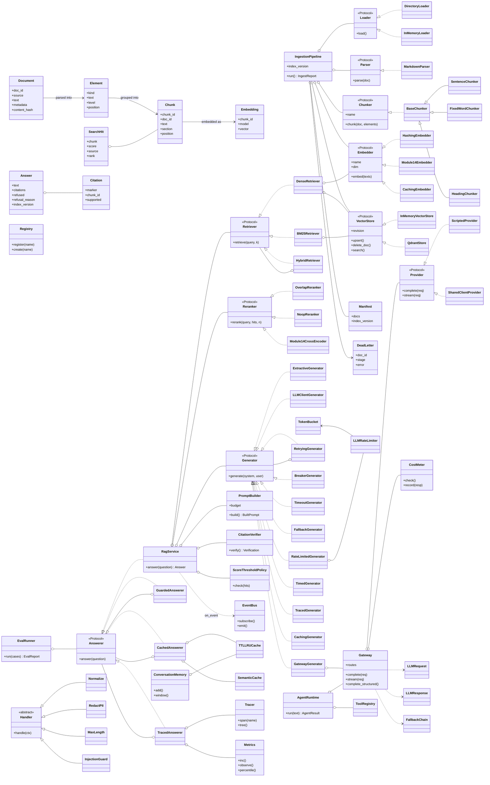

# Module 20 — LLM System Low-Level Design (LLD)

Classes, interfaces, patterns, contracts and failure handling for LLM and RAG systems: what an LLD / machine-coding interview round asks. Built around one small, tested, real Python package, [`ragkit/`](ragkit/), that grows step by step. Every number in the walkthroughs comes from a real run on a laptop CPU, offline.

## The story of this module
Module [14](../14_rag_and_retrieval/README.md) taught *what* a RAG system does; module [10](../10_ml_system_architecture/README.md) drew its boxes and arrows (HLD). This module opens one box and designs what is inside.
- **Pain point:** a working demo (one big class, dicts, `if provider == ...`) cannot be tested without models, cannot swap a vector DB or a provider, and fails badly at 3 a.m. when the API returns 503. In an interview you are asked to *design* it, not just to build it.
- **Spark:** small contracts (`typing.Protocol`), immutable value objects, constructor injection, and a handful of patterns used for a reason. The volatile parts (model, store, clock) sit behind seams, so tests use fakes and production uses adapters.
- **What you build:** `ragkit`, about 2,500 lines in 18 modules with 140 tests: domain model, ingestion pipeline (idempotent, incremental, dead-letter, versioned), query pipeline (hybrid retrieval, reranker, token-budget prompt builder, citation verifier, refusal policy), a plugin registry, a Qdrant adapter, retry/breaker/rate-limiter/fallback, exact and semantic caches, an LLM gateway with streaming and structured output, tracing/metrics/eval hooks, six interview problems, and a governance layer (prompt/model versioning with canary rollout, input/output guardrails, context/tenant/cost budgets).
- **Cliffhanger:** the design is complete at the *object* level. Making it serve many users is HLD (module 10), an API ([09](../09_api_development/)), containers ([11](../11_docker/)), and agentic systems ([08](../08_agent_harness/)).

**Short on time?** Read [INTERVIEW_GIST.md](INTERVIEW_GIST.md) first: the whole module on one page, with a quick-fire Q&A.

## 1. Why this matters
"Design the classes of a RAG service", "design a rate limiter for an LLM API", "design an eval harness", "design a tool-calling agent runtime" are now standard LLD and machine-coding questions at AI product companies. A strong answer shows a frame (requirements, entities, interfaces, diagrams, edge cases, tests), the right patterns for the right reasons, explicit failure handling, and testability.

## 2. Where this fits
**Builds on**
- [00_python_foundations](../00_python_foundations/05_classes_and_dataclasses/WALKTHROUGH.md): classes and dataclasses; [07_modules_decorators_generators](../00_python_foundations/07_modules_decorators_generators/WALKTHROUGH.md): decorators and generators.
- [14_rag_and_retrieval](../14_rag_and_retrieval/README.md): the stages we now design as classes; its `Embedder` and `CrossEncoderReranker` are reused through adapters, its knowledge base and 29 labelled questions are our data.
- [10_ml_system_architecture](../10_ml_system_architecture/README.md): HLD, logging/monitoring (step 09 here adds LLM-specific telemetry).
- [08_agent_harness](../08_agent_harness/README.md): the agent loop that step 10 redesigns as a runtime; [shared/llm_client.py](../shared/llm_client.py): the mock/local/Anthropic client the gateway wraps.
- [04_llm_fundamentals](../04_llm_fundamentals/README.md) and [05_llm_parameters](../05_llm_parameters/README.md): tokens, context windows, sampling.

**Leads to**
- [09_api_development](../09_api_development/): put `build_system(config)` behind FastAPI endpoints (pydantic request models, streaming responses).
- [11_docker](../11_docker/) and [13_capstone_project](../13_capstone_project/): package and ship it.

## 3. Concept map
```
                    +---------------- build_system(config) = composition root (05) ----------------+
                    |                                                                              |
OFFLINE (03)        v                                                           ONLINE (04)         v
Loader -> Parser -> Chunker -> Embedder -> VectorStore  <----------------- Retriever (dense|BM25|hybrid) -> Reranker
   |         |          |          |            ^  memory | Qdrant (05)                                      |
 Document  Element    Chunk    Embedding       |  adapter                      refuse? <- ScoreThresholdPolicy
 (02)                 (content-hash id)    index_version / manifest / DLQ                |
                                                                          PromptBuilder (token budget) -> Generator
                                                                                                           |
                                                                                    CitationVerifier -> Answer (02)
WRAPPERS (Decorators, 05):  Guard chain -> Traced (09) -> Cached (07) -> RagService -> Retrying/Breaker/Timeout/RateLimited (06) -> Gateway (08)
                            Gateway: alias -> providers + fallback + CostMeter + streaming + structured output + tools
PROBLEMS (10): RAG service | chunker library | rate limiter | eval harness | conversation memory | agent runtime
FOUNDATIONS (01): LLD vs HLD, SOLID, Protocol vs ABC, frozen+slots dataclasses, enums, dependency injection, diagrams
```

## 4. Study path
| Step | Folder | You learn | Run | Time |
|---|---|---|---|---|
| 1 | [01_lld_foundations](01_lld_foundations/) | LLD vs HLD, SOLID with LLM examples, Protocol vs ABC, frozen/slots dataclasses, enums, DI, reading diagrams | `python main.py` | 45 min |
| 2 | [02_domain_model](02_domain_model/) | Document/Element/Chunk/Embedding/SearchHit/Citation/Answer, content-hash vs uuid ids, validation, JSON round trip, dataclass vs pydantic | `python main.py` | 60 min |
| 3 | [03_ingestion_pipeline](03_ingestion_pipeline/) | five interfaces, idempotent upsert, incremental re-index, batching, dead-letter, index versioning | `python main.py` | 75 min |
| 4 | [04_query_pipeline](04_query_pipeline/) | dense/sparse/hybrid Strategy, reranker, token-budget PromptBuilder, citation verifier, refusal policy, adapters over module 14 | `python main.py` | 75 min |
| 5 | [05_design_patterns_in_llm_apps](05_design_patterns_in_llm_apps/) | Strategy, Registry/Factory, Adapter (Qdrant), Decorator, Chain of Responsibility, Observer, Template Method | `python main.py` | 75 min |
| 6 | [06_resilience](06_resilience/) | retry + backoff + jitter, timeout, circuit breaker, token bucket, fallback, idempotency keys, fake clock | `python main.py` | 70 min |
| 7 | [07_caching](07_caching/) | exact + semantic cache, TTL, LRU, invalidation by index version, provider prompt caching | `python main.py` | 60 min |
| 8 | [08_llm_gateway_and_streaming](08_llm_gateway_and_streaming/) | unified types, routing, streaming (sync/async), structured output repair loop, tool schemas, cost meter | `python main.py` | 75 min |
| 9 | [09_observability_and_eval_hooks](09_observability_and_eval_hooks/) | spans, JSON logs, metrics (p50/p95), OTel GenAI names, online eval hooks, feedback | `python main.py` | 60 min |
| 10 | [10_lld_interview_problems](10_lld_interview_problems/) | six worked designs: requirements -> entities -> interfaces -> diagrams -> edge cases -> tests | `python main.py` | 90 min |
| 11 | [11_versioning_guardrails_and_budgets](11_versioning_guardrails_and_budgets/) | prompt registry (semver + content hash), model pinning, A/B and canary by hash of user id, rollback; input/output guardrails (PII, injection, schema, groundedness, refusal); context-window, per-tenant token and cost budgets | `python main.py` | 75 min |

**Overlaps with other modules (intro there, production design here).** These steps deliberately go deeper than the first treatment elsewhere; read the intro first if the topic is new.
| Here | Intro there | What this module adds |
|---|---|---|
| [06 resilience](06_resilience/WALKTHROUGH.md) | [08_agent_harness/06 errors and retries](../08_agent_harness/06_errors_and_retries/WALKTHROUGH.md), [10/08 scalability and reliability](../10_ml_system_architecture/08_scalability_and_reliability/WALKTHROUGH.md) | error taxonomy as classes, jitter maths, breaker state machine, token bucket, composable decorators with a fake clock |
| [07 caching](07_caching/WALKTHROUGH.md) | [10/08](../10_ml_system_architecture/08_scalability_and_reliability/WALKTHROUGH.md), [14/10 advanced RAG](../14_rag_and_retrieval/10_advanced_rag_and_vector_dbs/WALKTHROUGH.md) | exact vs semantic cache classes, scope in the key, invalidation by index version, provider prompt-cache arithmetic |
| [08 gateway and streaming](08_llm_gateway_and_streaming/WALKTHROUGH.md) | [shared/llm_client.py](../shared/llm_client.py), [09_api_development/10 streaming SSE](../09_api_development/10_streaming_sse/WALKTHROUGH.md) | unified request/response types, alias routing and fallback, cost meter, structured-output repair loop (the HTTP/SSE side stays in 09) |
| [09 observability](09_observability_and_eval_hooks/WALKTHROUGH.md) | [10/07 logging and monitoring](../10_ml_system_architecture/07_logging_and_monitoring/WALKTHROUGH.md), [08_agent_harness/08 trace](../08_agent_harness/08_trace_and_full_agent/WALKTHROUGH.md) | nested spans, trace-correlated JSON logs, p50/p95, OTel GenAI names, eval hooks, feedback |
| [11 versioning, guardrails, budgets](11_versioning_guardrails_and_budgets/WALKTHROUGH.md) | [10/04 model registry](../10_ml_system_architecture/04_model_registry_versioning/WALKTHROUGH.md), [07/07 prompt testing](../07_prompt_engineering/07_prompt_testing/WALKTHROUGH.md), [08/07 safety](../08_agent_harness/07_safety_and_permissions/WALKTHROUGH.md) | the serving side: pinned releases, canary routing, guard pipeline, window budgeting, tenant ledger (safety theory is not re-taught) |

Total about 11 hours including exercises. Each step has `main.py` (commented, runnable), `WALKTHROUGH.md` (story, theory, **Code, step by step** for `main.py` *and* the ragkit modules it introduces, real output, experiments, debugging drill) and `TERMS.md`. Then do [exercises.md](exercises.md) (worked answers in [solutions/](solutions/)).

Run from the repo root: `HF_HUB_OFFLINE=1 .venv/bin/python 20_llm_system_lld/<step>/main.py`, or `cd` into a step and `python main.py`. Everything is offline and CPU-only; step 04 loads the cached MiniLM and cross-encoder (a few seconds). Tests: `.venv/bin/python -m pytest 20_llm_system_lld/tests -q` (140 tests, about 1 s).

## 5. The ragkit package
| Module | Introduced in | What it holds |
|---|---|---|
| [`ids.py`](ragkit/ids.py), [`domain.py`](ragkit/domain.py), [`schemas.py`](ragkit/schemas.py) | 02 | content-hash/uuid ids, 7 value objects, pydantic models |
| [`protocols.py`](ragkit/protocols.py), [`chunking.py`](ragkit/chunking.py), [`ingest.py`](ragkit/ingest.py) | 03 | contracts, Template Method chunkers, loaders, parser, hashing embedder, in-memory store, `IngestionPipeline`, `Manifest`, dead letters |
| [`query.py`](ragkit/query.py), [`adapters.py`](ragkit/adapters.py) | 04 | retrievers, RRF, rerankers, `PromptBuilder`, verifier, refusal, `RagService`; module 14 / llm_client adapters |
| [`patterns.py`](ragkit/patterns.py), [`decorators.py`](ragkit/decorators.py), [`qdrant_store.py`](ragkit/qdrant_store.py), [`factory.py`](ragkit/factory.py) | 05 | Registry, EventBus, guard chain, caching/timing decorators, Qdrant adapter, `build_system` |
| [`resilience.py`](ragkit/resilience.py), [`testing.py`](ragkit/testing.py) | 06 | errors, retry, timeout, breaker, token bucket, fallback, idempotency; `FakeClock`, `FlakyGenerator` |
| [`cache.py`](ragkit/cache.py) | 07 | `TTLLRUCache`, `SemanticCache`, `CachedAnswerer`, prompt-cache arithmetic |
| [`gateway.py`](ragkit/gateway.py) | 08 | request/response types, providers, `Gateway`, `CostMeter`, structured output, `ToolSpec` |
| [`observability.py`](ragkit/observability.py) | 09 | `Tracer`, `JsonLogger`, `Metrics`, traced decorators, eval hooks, feedback |
| [`governance.py`](ragkit/governance.py) | 11 | `PromptRegistry`, `ReleaseConfig`, `CanaryRouter`, input guard handlers, `OutputGuard`, `ContextBudget`, `TenantGate`, `Ledger`, `GovernedService` (plus `FakeJsonProvider` in `testing.py`) |
| [`ratelimit.py`](ragkit/ratelimit.py), [`memory.py`](ragkit/memory.py), [`evalkit.py`](ragkit/evalkit.py), [`agent.py`](ragkit/agent.py) | 10 | the four problem-specific modules |

## The full ragkit class diagram

A text version of the same structure: *domain objects* flow through *Protocols*; *implementations* satisfy them; *decorators* wrap Protocols to add retry, cache, tracing; *`build_system(config)`* wires everything.

## 6. The concepts, one by one

### LLD vs HLD, SOLID, contracts (step 01)
LLD designs classes, interfaces and collaborations inside one service; HLD chooses services and stores. Use `Protocol` for contracts between components (structural, no inheritance), `ABC` only when you also ship shared behaviour. `runtime_checkable` checks attribute **names** only, not signatures (a one-argument `generate` still passes). Make data `frozen=True, slots=True`; inject collaborators through constructors.

### Domain model and ids (step 02)
Chunk id = `hash(doc_id, section, text)`: stable under unrelated edits, so re-indexing is idempotent. Do not hash the position (inserting a paragraph would change every later id). `frozen` is shallow: use tuples and read-only mappings. Pydantic at trust boundaries (HTTP, LLM JSON), dataclasses inside.

### Ingestion (step 03)
Diff chunk ids against the store: new -> embed in batches, stale -> delete, unchanged -> skip. A manifest of `{doc_id: content_hash}` makes it incremental; failures go to a dead-letter list with their stage; `index_version = hash(embedder, dim, chunker)` forces a rebuild when vectors would change meaning. Content-hash ids only help if chunk boundaries are stable: an edit at the top re-embedded 1 of 7 heading chunks but 8 of 8 fixed windows.

### Query pipeline (step 04)
Retrieve broadly (hybrid, RRF), rerank precisely, **refuse before generating** when the best score is below a calibrated threshold, pack chunks greedily into a token budget (skip-and-continue), number the sources, generate, and verify citations (range and lexical support; not faithfulness). The gift-card example shows a false accept at threshold -6.5.

### Patterns (step 05)
Strategy (retrievers), Registry+Factory (plugins by name), Adapter (Qdrant, module 14), Decorator (cache, timing, retry, tracing), Chain of Responsibility (guards), Observer (event bus), Template Method (chunkers). Contract-test every adapter. Decorator order matters.

### Resilience (step 06)
Classify errors; retry transient ones with exponential backoff and **full jitter**, honour `retry-after`; timeouts per attempt; circuit breaker closed/open/half-open; token bucket for bursts and sustained rate; fallback only on infrastructure errors; idempotency keys for side effects. Test with a fake clock and a scripted flaky provider.

### Caching (step 07)
Exact key = hash of normalised prompt + params + **scope** (index version, model, tenant). TTL bounds staleness, LRU bounds size, versioned keys invalidate without scanning. Semantic caches match topics, not meaning ("shipping free" vs "shipping not free" = 0.93). Provider prompt caching: stable prefix first, write 1.25x, read about 0.1x, 5-minute TTL by default.

### Gateway (step 08)
Frozen request/response types, a two-method `Provider`, alias -> ordered providers, metered cost with a budget guard (`BudgetExceeded` is permanent), streaming by generator/async iterator (no mid-stream fallback), structured output with a bounded repair loop, one `ToolSpec` rendered per vendor.

### Observability (step 09)
Traces answer *where*, logs *what*, metrics *how much*; join on trace id. Report p50/p95, not means (mean 63 ms vs p95 900 ms). Context variables nest spans but do not cross plain threads. OpenTelemetry GenAI conventions are still in Development status.

### Interview problems (step 10)
Seven-step frame, six problems, each with requirements, entities, interfaces, class and sequence diagrams, edge cases and tests; all with running code.

### Versioning, guardrails, budgets (step 11)
Prompts and model settings are release artifacts: semantic version + content hash, immutable once published, pinned (prompt version + dated model snapshot) in a release, rolled out by hashing the user id into a bucket (the candidate owns the lowest buckets, so a ramp only adds users; percent 0 = rollback). Guards wrap the model: limits, PII redaction and injection heuristics in; JSON schema, citation grounding, confidence floor and a refusal policy out (repair format errors once, refuse content errors). Budgets: window = system + history + chunks + question + answer reserve, per-request `max_tokens`, per-tenant token bucket plus spend ceiling, and one ledger row per request.

## 7. Same thing, different names
| You will hear | Also called | Same? | One-line difference |
|---|---|---|---|
| LLD | low-level design, object design, class design, machine-coding round | mostly | LLD is the design discussion; machine-coding also asks for running code |
| HLD | system design, architecture | mostly | HLD picks services and stores; LLD designs classes inside one service |
| Interface | protocol, abstract base class (ABC), contract, port | no | interface = the idea; `Protocol` structural, `ABC` nominal (must inherit) |
| Strategy | policy, plugin, algorithm object | mostly | swap behaviour behind one interface; "plugin" stresses loading by name |
| Adapter | wrapper, driver, connector, shim | mostly | changes an interface; a Decorator keeps it and adds behaviour |
| Vector store | vector DB, vector index, index | no | index = the search structure; store = our interface; DB = a server product with filters and persistence |
| Reranker | cross-encoder, second-stage ranker | close | reranker is the role, cross-encoder one model type |
| Gateway | router, proxy, LLM proxy, AI gateway | mostly | gateway = entry point with policy; router = provider selection; proxy = pass-through |
| Tracing | spans, observability, APM | close | trace = tree of spans for one request; observability = traces + logs + metrics |
| Retry | backoff, jitter, retry policy | close | backoff = growing delay; jitter = random spread; policy = the settings |
| Dead-letter queue | error queue, quarantine | mostly | where failed items wait for inspection and replay |
| Idempotent | re-runnable, safe to retry | close | same result however many times it runs |
| Composition root | `main()`, wiring, DI container | close | the one place that names concrete classes |
| Prompt caching | prefix cache, context caching | close | provider-side reuse of a processed prompt prefix; not an answer cache |
| Canary release | staged rollout, progressive delivery | close | small growing share under watch; an A/B test is a fixed split for measuring a metric |
| Guardrails | validators, safety filters, moderation | close | checks around the model; moderation is one kind |
| Context budget | token budget, window budgeting | mostly | how the window is split among system, history, chunks, question and answer reserve |

## 8. Interview Q&A
**Q: What is the difference between HLD and LLD?** HLD chooses components and their interaction (services, stores, queues, scale). LLD designs the classes, interfaces and flows inside one component, with patterns, failure handling and tests.
**Q: Protocol or ABC?** Protocol for contracts between components (structural, no inheritance, easy fakes); ABC when I ship shared behaviour with the abstract part, e.g. a Template Method base class. Note runtime `isinstance` on a Protocol only checks names.
**Q: How do you make RAG indexing idempotent and incremental?** Content-hash chunk ids, diff against the store (new / stale / unchanged), a manifest of document hashes, embed only new chunks in batches, update the manifest after success, dead-letter failures, version the index by embedder and chunker.
**Q: Where do you refuse to answer?** Before generation, when there are no hits or the best reranked score is under a calibrated threshold, plus a prompt rule. I measure false accepts and false refusals on labelled data.
**Q: How do you retry LLM calls safely?** Only transient errors, exponential backoff with full jitter, honour `retry-after`, a cap on attempts, a per-attempt timeout, idempotent operations only, a circuit breaker so retries do not hammer a dead provider, and no stacked retries across layers.
**Q: Design a rate limiter for an LLM API.** Two token buckets (requests and tokens per minute) per tenant, reserve the worst-case tokens before the call and settle after; check both before spending either; monotonic clock; Redis plus an atomic script when distributed.
**Q: Exact vs semantic cache?** Exact: key is a hash of normalised prompt, params and a scope with the index version; safe. Semantic: similarity threshold; saves more but can return a wrong answer for a near-miss ("not free"), so high threshold, same scope, never across tenants, never cache refusals.
**Q: How does provider prompt caching work and how do you exploit it?** The API reuses the processed prefix (tools, system, then messages) up to a breakpoint when it is byte-identical; default 5-minute TTL refreshed on hits; writes cost 1.25x, reads about 0.1x. Put stable content first, volatile last.
**Q: How do you make structured output reliable?** Constrained decoding or tool schemas where the provider offers them, always validate with pydantic, and a bounded repair loop that returns the validation error to the model; track the repair rate.
**Q: What do you trace and measure in an LLM service?** Spans per stage, tokens, cost per request, p50/p95 latency, cache hit rate, refusal and retry rates, citation-valid rate, flags from online eval hooks; join logs and traces by trace id; user feedback becomes regression cases.
**Q: How would you test this?** Fakes for the model, a scripted flaky provider, a fake clock, contract tests per Protocol, idempotency and round-trip property tests, an end-to-end test, and an eval-harness regression gate.
**Q: What goes wrong with patterns?** Singletons for clients, a class hierarchy for one `if`, subscribers that can crash the emitter, and decorators stacked in the wrong order.
**Q: How do you version and roll out a prompt change?** Semantic version plus content hash, immutable once published, pinned in a release with the exact model snapshot. Offline eval gate first, then a canary: hash the user id into a bucket, give the candidate the lowest buckets, ramp 5 -> 25 -> 100 while watching refusal rate, citation-valid rate, latency, cost and thumbs-down; percent 0 is the rollback.
**Q: What guardrails would you put on a RAG service?** In: length limits, PII redaction, injection heuristics (one weak layer). Out: JSON schema validation, every citation must exist and be supported by a retrieved chunk, confidence floor, PII scrub, one repair for format errors and a fixed refusal for ungrounded answers.
**Q: How do you budget the context window?** window = system + history + chunks + question + answer reserve; reserve first, then drop oldest history and lowest-ranked chunks, never the system prompt or the current question, and report what was dropped.
**Q: How do you stop one tenant from burning the budget?** Per-tenant token bucket (tokens per minute) plus a spend ceiling; reserve the worst case before the call, settle after; rate exhaustion is a retryable 429 with retry-after, budget exhaustion is permanent until the period resets; a ledger row per request.

## 9. Self-check
- Can you list the seven steps of the LLD frame and apply them to "design a prompt template manager"?
- Why does `isinstance(x, Generator)` pass for a one-argument `generate`?
- Why is `position` not in the chunk id? What breaks if it is?
- Which of retry, breaker, timeout, limiter wraps which, and why?
- Why must `BudgetExceeded` and `PermanentError` not trigger fallback?
- Why did `if self.semantic:` break the cache, and what is the fix?
- Compute the RRF score of a chunk ranked 1st and 3rd in two lists (k=60).
- What do p50 and p95 tell you that the mean does not?
- Draw the sequence diagram of a refused question and of an answered one.
- Why must the canary own the *lowest* buckets, and what happens if two experiments share a salt?
- Where in the request path do the three refusal points sit (input, retrieval, output), and which one costs nothing?

## References (checked Nov 2026)
- Claude API errors and retry guidance: https://platform.claude.com/docs/en/api/errors
- Claude prompt caching (prefix order, TTL, multipliers, usage fields): https://platform.claude.com/docs/en/build-with-claude/prompt-caching
- OpenTelemetry GenAI semantic conventions (the OTel site says they moved): https://opentelemetry.io/docs/specs/semconv/gen-ai/ and https://github.com/open-telemetry/semantic-conventions-genai
- Status of the GenAI conventions as Development (secondary sources, May-Sept 2026; verify against the repository): https://www.dash0.com/knowledge/opentelemetry-genai-semantic-conventions-explained and https://www.greptime.com/blogs/2026-05-09-opentelemetry-genai-semantic-conventions
- AWS Architecture Blog, Exponential Backoff and Jitter (full vs equal vs decorrelated jitter): https://aws.amazon.com/blogs/architecture/exponential-backoff-and-jitter/
- Python `typing.Protocol` and `runtime_checkable` (names only, signatures ignored): https://docs.python.org/3/library/typing.html
- Python dataclasses (`frozen`, `slots`): https://docs.python.org/3/library/dataclasses.html
- pydantic v2 docs: https://docs.pydantic.dev/latest/
- Qdrant documentation (the local `:memory:` mode was verified by running `QdrantClient(":memory:")` with qdrant-client 1.20.0 in this repo): https://qdrant.tech/documentation/
- Reciprocal Rank Fusion: Cormack, Clarke, Buettcher, SIGIR 2009 (k = 60).
- Design Patterns (Gamma, Helm, Johnson, Vlissides): Strategy, Adapter, Decorator, Chain of Responsibility, Observer, Template Method.
- Module 14 (RAG), module 10 (architecture), module 08 (agents) of this repository.
